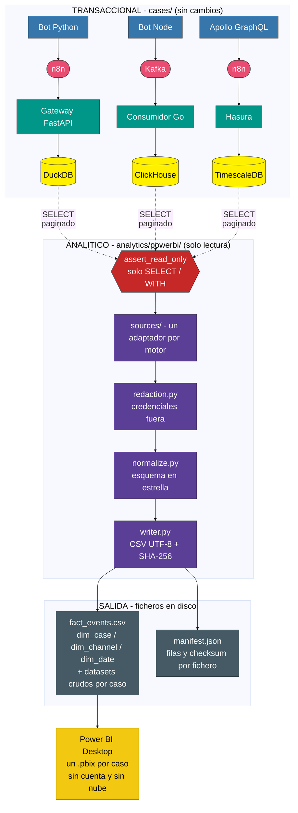
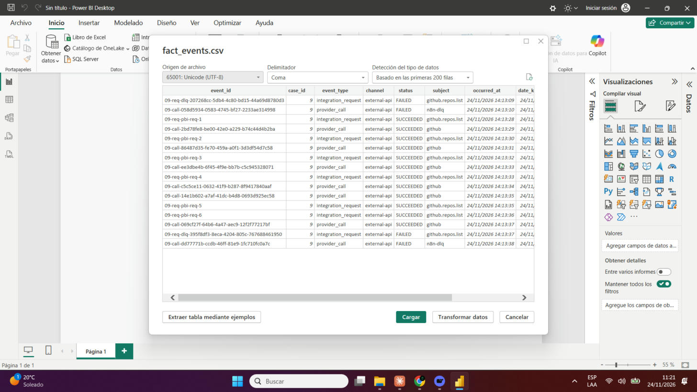
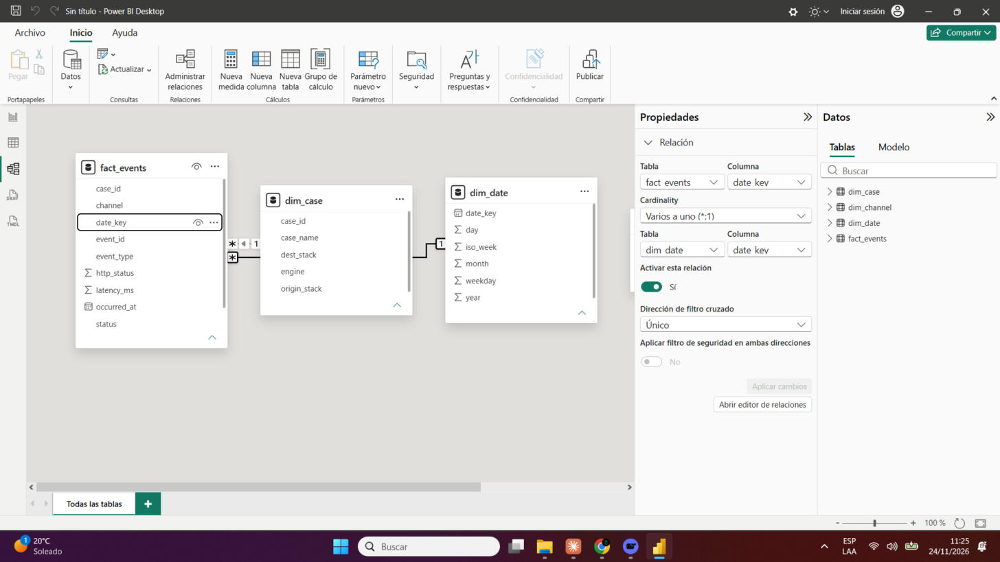
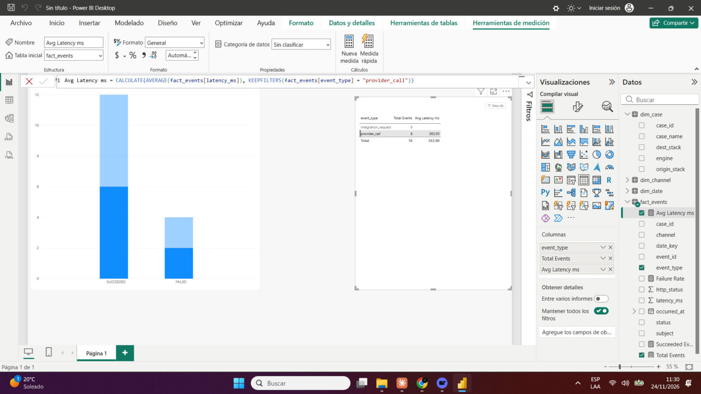
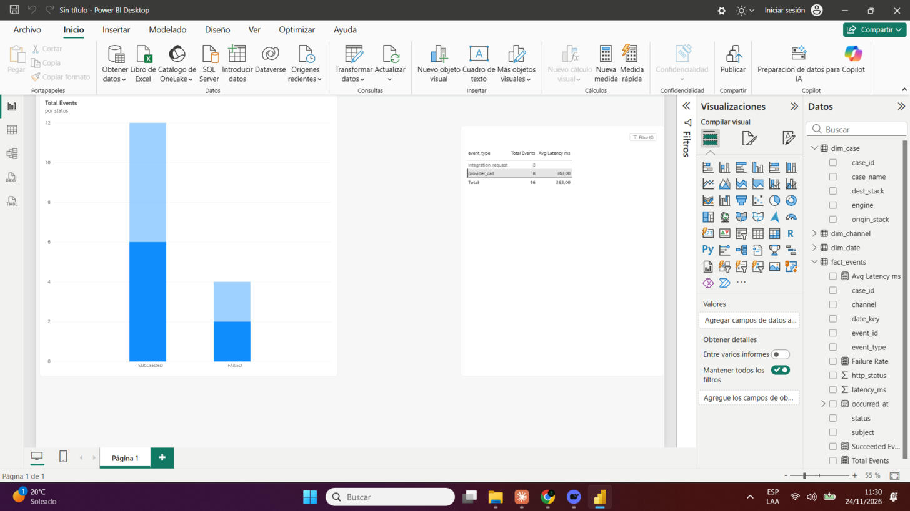
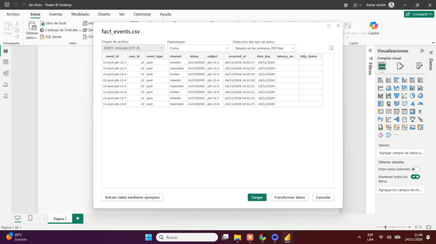
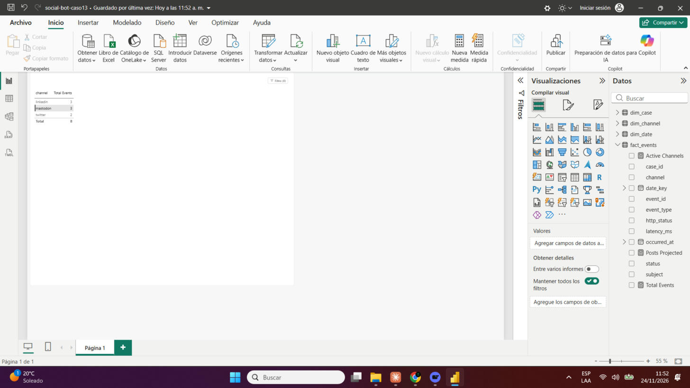
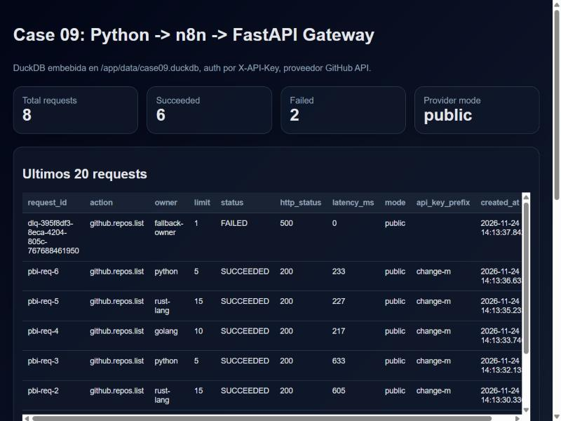
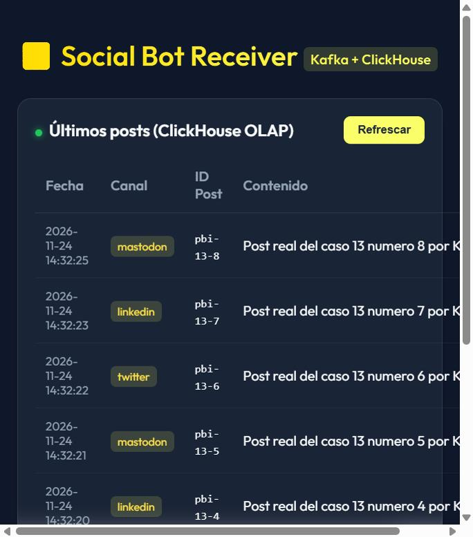
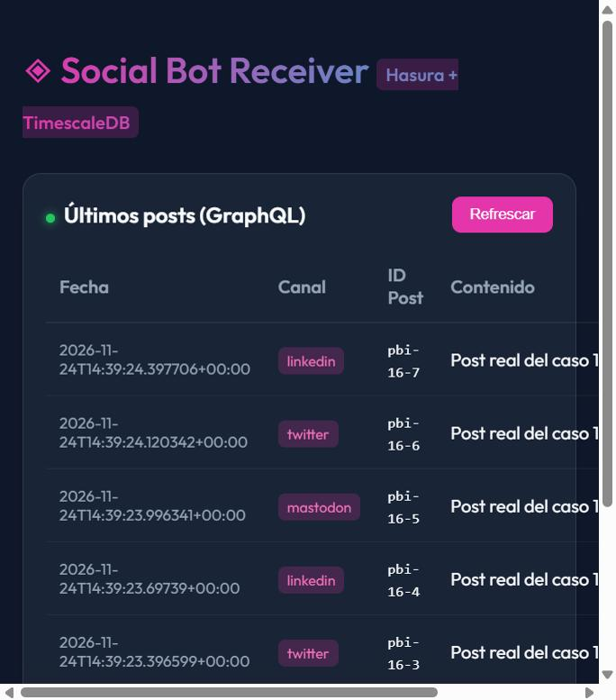

# Integración con Microsoft Power BI

> **Estado: implementado y verificado el 2026-11-24** sobre los casos 09, 13 y
> 16, con datos reales generados en cada stack y cargados en Power BI Desktop
> 2.160.1151.0 (Windows 11). Lo que todavía **no** está hecho se enumera en
> [Limitaciones](#9-limitaciones-y-pendientes), separado de lo que sí.

Este documento explica cómo el laboratorio expone sus datos a Power BI, y cómo
reproducir el informe paso a paso. Es la referencia completa: arquitectura,
instalación, uso, pruebas, seguridad, costos y resolución de errores.

---

## Tabla de contenidos

1. [Qué hace y qué no hace esta integración](#1-qué-hace-y-qué-no-hace-esta-integración)
1. [¿Por qué los casos 09, 13 y 16?](#1bis-por-qué-los-casos-09-13-y-16-y-no-otros)
2. [Arquitectura](#2-arquitectura)
3. [Requisitos](#3-requisitos)
4. [Paso a paso: de cero a un informe](#4-paso-a-paso-de-cero-a-un-informe)
5. [Guía de Power BI Desktop con capturas](#5-guía-de-power-bi-desktop-con-capturas)
6. [Modelo de datos y medidas](#6-modelo-de-datos-y-medidas)
7. [Seguridad](#7-seguridad)
8. [Pruebas](#8-pruebas)
9. [Limitaciones y pendientes](#9-limitaciones-y-pendientes)
10. [Resolución de errores](#10-resolución-de-errores)
11. [Costos](#11-costos)

---

## 1. Qué hace y qué no hace esta integración

**Hace:**

- Exporta a CSV, de forma reproducible y **solo lectura**, los datos reales que
  cada caso ya tiene en su motor analítico.
- Normaliza los tres casos a un esquema en estrella común para poder
  compararlos en un mismo informe.
- Trae un informe `.pbix` por caso, ya construido, más las medidas DAX.
- Funciona **sin cuenta de Power BI y sin servicios en la nube**: todo es
  Power BI Desktop leyendo ficheros locales.

**No hace:**

- No cambia el comportamiento de ningún caso. No escribe en ninguna base de
  datos; cada consulta pasa por un guardia que solo admite `SELECT`.
- No crea un caso numerado nuevo: vive en `analytics/powerbi/`, fuera de
  `cases/`.
- No entra en el perfil Docker `full`. Es opcional por construcción.
- No toca n8n ni los dashboards existentes de cada caso.

> **Power BI no depende de Docker.** Docker solo hace falta en el momento de
> exportar. Una vez los CSV están en disco, se puede construir y refrescar el
> informe con todos los contenedores apagados. Es lo que permite recorrer los
> casos de uno en uno sin tener los tres consumiendo recursos.

---

## 1.bis ¿Por qué los casos 09, 13 y 16, y no otros?

Conviene ser transparente: **la elección vino del encargo, no de una propiedad
exclusiva del repositorio.** Como todo acaba en CSV, el motor de origen no
condiciona lo que Power BI puede hacer después.

Dicho eso, la selección sí tiene una lógica defendible: son los tres casos cuyo
destino es un motor **pensado para lectura analítica**, y entre los tres cubren
tres paradigmas distintos:

| Caso | Motor | Paradigma analítico |
| :--- | :--- | :--- |
| 09 | DuckDB | OLAP embebido, en proceso |
| 13 | ClickHouse | OLAP columnar distribuible |
| 16 | TimescaleDB | series temporales sobre PostgreSQL |

**No son los únicos que podrían exportarse.** Otros casos del laboratorio
también persisten historia y admitirían un adaptador igual de bien:

| Caso | Almacén persistente |
| :--- | :--- |
| 01 | MySQL |
| 10 | PostgreSQL |
| 12 | PostgreSQL + pgvector |
| 14 | PostgreSQL vía PostgREST |
| 15 | CockroachDB |
| 17 | InfluxDB (series temporales, tan analítico como el 16) |
| 18 | Neo4j |

El caso 17 es el ejemplo más claro de que la frontera no es nítida: InfluxDB es
una base de series temporales, igual que TimescaleDB.

Por eso el módulo está hecho para crecer: **añadir un caso son dos piezas**, un
`DatasetContract` en `contracts.py` y una clase adaptadora en `sources/` que
implemente `fetch_page()`. El resto —redacción, paginación, normalización al
esquema en estrella, CSV, manifiesto y validación— ya es común. Un adaptador
nuevo ronda las 60 líneas.

---

## 2. Arquitectura



Tres lecturas del diagrama, que son las tres decisiones de diseño:

- **Las flechas cruzan en un solo sentido.** Del mundo transaccional al
  analítico, nunca al revés. Ningún componente de `analytics/` abre una
  conexión de escritura, y ningún caso sabe que la capa analítica existe.
- **Todo pasa por el mismo cuello de botella.** `assert_read_only` es el único
  camino hacia los motores: no hay un atajo por caso.
- **La frontera con Power BI son ficheros, no una conexión.** Por eso el
  informe funciona con los contenedores apagados.

### Por qué `docker exec` y no un driver

Cada motor ya trae su cliente dentro de su contenedor (`clickhouse-client`,
`psql`, `duckdb`). Usarlos evita añadir dependencias nuevas de Python al
repositorio —el caso 13 no publica ningún puerto en el anfitrión, y eso es
deliberado— y mantiene la superficie de red igual que antes.

El caso 09 es la excepción útil: su DuckDB está montada en el anfitrión, así
que el adaptador la abre directamente con `read_only=True` si la librería
`duckdb` está disponible, y **cae al cliente del contenedor** si no puede (por
ejemplo cuando el contenedor escribió el fichero con una versión de DuckDB más
nueva que la del anfitrión, que es lo que ocurre hoy).

---

## 3. Requisitos

| Componente | Versión usada en la verificación | Obligatorio |
| :--- | :--- | :--- |
| Windows 11 | 11 Home 26300 | para Power BI Desktop |
| Power BI Desktop | 2.160.1151.0 (Microsoft Store) | sí, para el informe |
| Python | 3.13 | sí, para exportar |
| Docker Desktop | 29.9.3 | solo al exportar |
| `duckdb` (pip) | 1.5.5 | opcional (caso 09, vía fichero) |

No hace falta cuenta de Power BI, ni Fabric, ni ninguna pasarela.

---

## 4. Paso a paso: de cero a un informe

El recorrido completo, caso por caso. Cada caso se levanta, se exporta y se
apaga antes de pasar al siguiente, de modo que nunca hay más de un stack en
memoria.

### 4.1 Ver qué datasets existen

```powershell
python -m analytics.powerbi.cli list
```

### 4.2 Probar Power BI sin levantar nada (datos sintéticos)

Si solo quieres montar el modelo y las medidas antes de tocar Docker:

```powershell
python -m analytics.powerbi.cli sample --out analytics/powerbi/samples
```

Genera datos sintéticos deterministas con exactamente la misma forma que los
reales. Van etiquetados como sintéticos en el `manifest.json` y viven en una
carpeta distinta, así que no se confunden con una exportación real.

### 4.3 Caso 09 — gateway FastAPI sobre DuckDB

```powershell
docker compose --profile case09 up -d --build
```

Genera tráfico real contra el gateway (ajusta `INTEGRATION_API_KEY` si lo has
cambiado en tu `.env`):

```powershell
curl.exe -X POST http://127.0.0.1:8089/webhook -H "Content-Type: application/json" -H "X-API-Key: change-me-integration-key" --data '{\"id\":\"demo-1\",\"channel\":\"external-api\",\"action\":\"github.repos.list\",\"params\":{\"owner\":\"python\",\"limit\":5},\"ts\":\"2026-11-24T10:00:00Z\"}'
```

> El caso 09 valida un vocabulario cerrado: `channel` debe ser `external-api` y
> `action` debe ser `github.repos.list`. Cualquier otro valor devuelve 422.

Exporta y apaga:

```powershell
python -m analytics.powerbi.cli export --case 09 --out analytics/powerbi/exports/case09
```

```powershell
docker compose --profile case09 down --remove-orphans
```

```powershell
docker rmi social-bot-scheduler-dest-gateway-09:latest
```

### 4.4 Caso 13 — Kafka + consumidor Go + ClickHouse

```powershell
docker compose --profile case13 up -d --build
```

```powershell
curl.exe -X POST http://127.0.0.1:8093/webhook -H "Content-Type: application/json" --data '{\"id\":\"demo-13-1\",\"text\":\"Hola desde Kafka\",\"channel\":\"twitter\"}'
```

```powershell
python -m analytics.powerbi.cli export --case 13 --out analytics/powerbi/exports/case13
```

```powershell
docker compose --profile case13 down --remove-orphans
```

```powershell
docker rmi social-bot-scheduler-dest-go-13:latest clickhouse/clickhouse-server:24.8-alpine apache/kafka:3.8.0
```

### 4.5 Caso 16 — Hasura sobre TimescaleDB

```powershell
docker compose --profile case16 up -d --build
```

> Si `dest-graphql-16` se queda en estado `Created`, es porque Hasura tardó más
> que su `start_period` en pasar el healthcheck. Arráncalo cuando Hasura ya
> esté sano: `docker compose --profile case16 up -d dest-graphql-16`.

```powershell
curl.exe -X POST http://127.0.0.1:8096/webhook -H "Content-Type: application/json" --data '{\"id\":\"demo-16-1\",\"text\":\"Hola desde Hasura\",\"channel\":\"linkedin\"}'
```

```powershell
python -m analytics.powerbi.cli export --case 16 --out analytics/powerbi/exports/case16
```

```powershell
docker compose --profile case16 down --remove-orphans
```

```powershell
docker rmi social-bot-scheduler-dest-graphql-16:latest hasura/graphql-engine:v2.44.0 timescale/timescaledb:2.17.2-pg16
```

### 4.6 Unir los tres casos sin levantar nada

```powershell
python -m analytics.powerbi.cli merge --dir analytics/powerbi/exports/case09 --dir analytics/powerbi/exports/case13 --dir analytics/powerbi/exports/case16 --out analytics/powerbi/exports/all
```

Lee los CSV que ya están en disco, deduplica y recalcula el esquema en
estrella. **No necesita Docker.**

### 4.7 Comprobar que una exportación es coherente

```powershell
python -m analytics.powerbi.cli validate --dir analytics/powerbi/exports/all
```

Verifica el `manifest.json` contra los ficheros: versión de contrato, número de
filas, SHA-256, cabeceras y ausencia de columnas prohibidas.

---

## 5. Guía de Power BI Desktop con capturas

Hay **un archivo `.pbix` por caso**, ya construido, en
`analytics/powerbi/reports/`:

| Archivo | Lee de | Contenido |
| :--- | :--- | :--- |
| `social-bot-caso09.pbix` | `exports/case09` | eventos por estado y latencia media por tipo |
| `social-bot-caso13.pbix` | `exports/case13` | posts por canal |
| `social-bot-caso16.pbix` | `exports/case16` | posts por canal |

Si solo quieres abrirlos, haz doble clic y pulsa **Actualizar** tras una
exportación nueva. Lo que sigue es cómo se construye uno desde cero.

### Paso 1 — Informe en blanco

Abre Power BI Desktop y elige **Informe en blanco**.

### Paso 2 — Conectar el CSV de hechos

**Inicio → Obtener datos → Texto o CSV → Conectar**, y escribe la ruta
completa del fichero, por ejemplo
`C:\dev\social-bot-scheduler\analytics\powerbi\exports\case09\fact_events.csv`.

Power BI muestra la vista previa. Comprueba dos cosas antes de cargar:

- **Origen de archivo** debe decir `65001: Unicode (UTF-8)`. Lo detecta solo
  gracias al BOM que escribe el exportador.
- **Delimitador** debe ser `Coma`.



Pulsa **Cargar**.

### Paso 3 — Cargar las dimensiones

Repite el paso 2 para `dim_case.csv`, `dim_channel.csv` y `dim_date.csv` de la
misma carpeta. El cuadro de diálogo recuerda la carpeta, así que basta con
escribir el nombre del fichero.

Al terminar, el panel **Datos** debe mostrar las cuatro tablas.

### Paso 4 — Revisar y completar las relaciones

Ve a la **vista de modelo** (tercer icono de la barra izquierda).

Power BI detecta solo la relación `fact_events[case_id] → dim_case[case_id]`,
con cardinalidad **Varios a uno (\*:1)** y dirección **Único**. La de fechas
hay que crearla arrastrando `fact_events[date_key]` sobre
`dim_date[date_key]`; la de canal, igual con `channel`.



En **Modelado → Marcar como tabla de fechas** marca `dim_date` con la columna
`date_key`. Sin ese paso, las medidas de inteligencia de tiempo fallan.

### Paso 5 — Crear las medidas DAX

Selecciona la tabla `fact_events` en el panel Datos y pulsa **Nueva medida**.
Pega cada medida de `analytics/powerbi/dax/measures.dax`, una por una.

Las cuatro mínimas para empezar:

```dax
Total Events = COUNTROWS(fact_events)
Succeeded Events = CALCULATE(COUNTROWS(fact_events), KEEPFILTERS(fact_events[status] = "SUCCEEDED"))
Failure Rate = DIVIDE(CALCULATE(COUNTROWS(fact_events), KEEPFILTERS(fact_events[status] = "FAILED")), COUNTROWS(fact_events))
Avg Latency ms = CALCULATE(AVERAGE(fact_events[latency_ms]), KEEPFILTERS(fact_events[event_type] = "provider_call"))
```



> **`KEEPFILTERS` no es opcional.** Un filtro suelto dentro de `CALCULATE`
> *sustituye* al filtro que ya haya sobre esa columna. Sin `KEEPFILTERS`, una
> tabla cortada por `event_type` mostraba 363 ms de latencia media también en
> la fila `integration_request`, que no mide latencia ninguna. Con
> `KEEPFILTERS` esa celda queda en blanco, que es lo correcto. Se detectó
> ejecutando el informe, no leyendo el código.

### Paso 6 — Construir los visuales

Con el lienzo deseleccionado, marca la casilla de un campo y la de una medida
en el panel Datos: Power BI crea el visual. Por ejemplo `status` + `Total
Events` da el gráfico de eventos por estado.

Este es el informe del caso 09 con sus datos reales —12 eventos correctos, 4
fallidos, y la latencia media solo donde tiene sentido:



### Paso 7 — Guardar

**Ctrl+S → Más opciones → Examinar este dispositivo**, y guarda en
`analytics/powerbi/reports/`.

### Los otros dos casos

El procedimiento es idéntico; solo cambia la carpeta de origen.

**Caso 13** (`exports/case13`) — 8 posts proyectados desde Kafka en ClickHouse:





**Caso 16** (`exports/case16`) — 7 posts persistidos vía Hasura en TimescaleDB:


Las cifras de cada informe se pueden contrastar con el dashboard propio del
caso, que sigue funcionando igual que antes de esta integración:

| Caso | Dashboard del caso |
| :--- | :--- |
| 09 |  |
| 13 |  |
| 16 |  |

---

## 6. Modelo de datos y medidas

El detalle completo —relaciones, tipos, granos y claves— está en
[`analytics/powerbi/model/DATA_MODEL.md`](../analytics/powerbi/model/DATA_MODEL.md).
Las medidas, en
[`analytics/powerbi/dax/measures.dax`](../analytics/powerbi/dax/measures.dax).

Resumen del esquema en estrella:

| Dataset | Tipo | Grano |
| :--- | :--- | :--- |
| `fact_events` | hecho | un evento observable de un caso |
| `dim_case` | dimensión | un caso del laboratorio |
| `dim_channel` | dimensión | un canal distinto observado |
| `dim_date` | dimensión | un día del calendario, sin huecos |

Más los datasets crudos de cada caso (`case09_requests`,
`case09_provider_calls`, `case09_repo_snapshots`, `case13_posts`,
`case16_posts`) para el detalle.

---

## 7. Seguridad

| Control | Cómo se implementa | Dónde se prueba |
| :--- | :--- | :--- |
| Solo lectura | `assert_read_only()` rechaza todo lo que no sea un único `SELECT`/`WITH` | `test_transport_and_sources.py` |
| Solo lectura en el motor | DuckDB `read_only=True`; PostgreSQL `default_transaction_read_only=on`; ClickHouse `readonly=1` por HTTP | mismo fichero |
| Sin credenciales exportadas | lista de denegación aplicada al contrato **y** a cada fila | `test_redaction_and_contracts.py` |
| Credenciales fuera de `argv` | `docker exec -e NOMBRE` (sin valor): Docker toma el valor del entorno del proceso cliente | `test_caso13_pasa_las_credenciales_por_entorno_no_por_argv` |
| Volumen acotado | paginación obligatoria y techo de filas (`--max-rows`, 50 000 por defecto) | `test_fetch_dataset_pagina_y_respeta_el_techo_de_filas` |
| Texto libre acotado | truncado a 500 caracteres | `test_truncate_text_acota_el_texto_libre` |
| Servicios en localhost | no se publica ningún puerto nuevo | el `compose.yml` no se modifica |

Concretamente: la tabla `integration_requests` del caso 09 guarda
`api_key_prefix` y `api_key_hash`. **Ninguna de las dos sale en la
exportación**, y el contrato ni siquiera se puede declarar con ellas: la
construcción del `DatasetContract` lanza `RedactionError`.

---

## 8. Pruebas

```powershell
python -m pytest tests/powerbi -q
```

87 pruebas, sin Docker y sin red. Cubren:

- **unitarias** — redacción, contratos, normalización, conversión de tipos;
- **de integración con los adaptadores** — con un `CommandRunner` falso que
  captura el comando y el entorno enviados, para comprobar que la sentencia es
  de lectura, que va paginada y que el secreto no viaja en `argv`;
- **de regresión del formato** — BOM, cabecera del contrato, `\r\n`, manifiesto
  con SHA-256, detección de un CSV manipulado;
- **de la CLI de punta a punta** — `sample`, `validate` y `merge` sobre
  directorios temporales, incluido el determinismo byte a byte.

---

## 9. Limitaciones y pendientes

**Limitaciones reales, no pendientes:**

- **La tasa de éxito de los casos 13 y 16 es 100 % por construcción.** Esas
  tablas solo almacenan los posts que llegaron; un fallo de publicación no deja
  rastro. Solo el caso 09 registra sus fallos, así que es el único cuya
  fiabilidad es medible. El modelo no lo disimula.
- **La latencia solo existe en el caso 09**, porque es el único que la mide.
- `dim_date` cubre únicamente el rango exportado, con un tope de 4 000 días.

**Pendientes, no implementados:**

- No hay conexión **DirectQuery** configurada. TimescaleDB es PostgreSQL, así
  que el conector nativo funcionaría publicando el puerto 5432 en loopback,
  pero no se ha hecho ni verificado.
- No hay publicación al servicio Power BI ni refresco programado.
- No hay adaptadores para los otros 17 casos.
- La exportación es manual: no hay tarea programada que la lance.

---

## 10. Resolución de errores

**`el caso 09 no es alcanzable` al exportar**
El contenedor no está en marcha. Levanta el perfil correspondiente.

**`Trying to read a database file with version number 999`**
El contenedor escribió la DuckDB con una versión más nueva que la del
anfitrión. El adaptador lo detecta y cae solo al cliente del contenedor; si
ves el error como fallo final, es que el contenedor tampoco está en marcha.

**`dest-graphql-16` se queda en `Created`**
Hasura no pasó el healthcheck dentro de su `start_period`. Vuelve a lanzar
`docker compose --profile case16 up -d dest-graphql-16` cuando Hasura esté
sano.

**Power BI muestra los acentos mal**
El CSV se abrió con la página de códigos equivocada. En el paso 2, **Origen de
archivo** debe decir `65001: Unicode (UTF-8)`.

**Una medida de latencia da el mismo valor en todas las filas**
Falta `KEEPFILTERS`. Ver el paso 5.

**`la exportación es INCONSISTENTE` tras exportar**
Algún CSV se modificó a mano después de escribirse. Vuelve a exportar; el
manifiesto compara SHA-256.

---

## 11. Costos

Cero en dinero. Power BI Desktop es gratuito y aquí no se usa ningún servicio
en la nube: ni el servicio Power BI, ni Fabric, ni pasarelas.

El costo es de recursos locales, y solo mientras se exporta:

| Caso | Contenedores | Memoria reservada aproximada |
| :--- | ---: | ---: |
| 09 | 1 | 256 MB |
| 13 | 3 | ~2,1 GB (Kafka 1 GB + ClickHouse 1 GB) |
| 16 | 3 | ~0,9 GB |

Recorrer los casos de uno en uno —levantar, exportar, apagar y borrar sus
imágenes— mantiene el pico en el caso más pesado en lugar de sumarlos.
