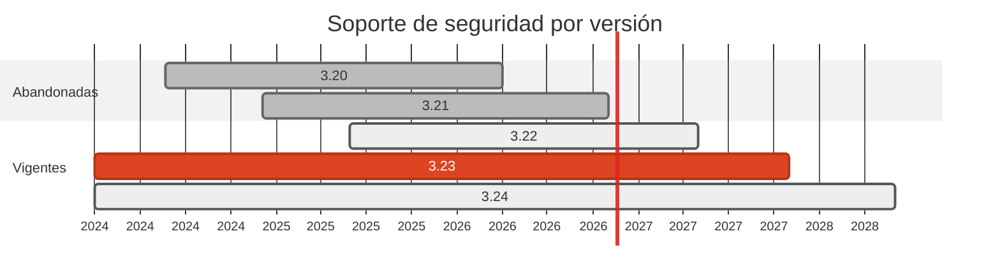

# 🏔️ Alpine 3.20 → 3.23.7

> La capa de sistema operativo de cinco imagenes estaba sin parches desde el 2026-04-01.

[← Volver al índice de actualizaciones](../VERSION_UPGRADES.md) · [README](../../README.md)

---

## Resumen

| | |
| :--- | :--- |
| **Casos afectados** | 5 (02, 13, 15, 17, 18) |
| **Cambios de versión registrados** | 5 |
| **Advisories cerrados en dependencias de este stack** | 0 |
| **Riesgo de ruptura** | Muy bajo |

## Ventanas de soporte

| Versión | Publicada | Fin de soporte | Estado |
| :--- | :--- | :--- | :--- |
| `3.20` | 2024-05-22 | 2026-04-01 | **EOL** |
| `3.21` | 2024-12-05 | 2026-11-01 | EOL hoy |
| `3.22` | 2025-05-29 | 2027-05-01 | con soporte |
| `3.23` | 2025-11-? | 2027-11-01 | **adoptada** |
| `3.24` | 2026-06-? | 2028-06-01 | recien salida |

## Por qué se cambió

- Alpine mantiene cada rama estable **dos años**. La 3.20 salió de soporte el 2026-04-01: `openssl`, `musl`, `busybox` y `zlib` dejaron de recibir parches en esas imagenes.

- Afecta a las imagenes de runtime de los casos 02, 13, 15, 17 y 18, que son binarios estaticos sobre `alpine` desnuda — precisamente donde la única superficie de ataque **es** el sistema operativo.

- Se pinnea al parche exacto (`3.23.7`) y no a `3.23`, para que el build sea reproducible y el guardrail de imagenes tenga algo concreto que comprobar.

## Implementación — dónde quedó escrito cada cambio

Las rutas de esta tabla las verifica `scripts/validate_security_manifests.py` en CI: si alguna no existe, el pipeline falla.

| Caso | Componente | De | A | Motivo | Fichero y mecanismo |
| :--- | :--- | :--- | :--- | :--- | :--- |
| 02 | dest | `3.20.6` | `3.23.7` | `eol` | `cases/02-python-to-go/dest/Dockerfile` (FROM de la imagen) |
| 13 | dest | `3.20` | `3.23.7` | `eol` | `cases/13-node-to-go-kafka/dest/Dockerfile` (FROM de la imagen) |
| 15 | origin | `3.20` | `3.23.7` | `eol` | `cases/15-grpc-go-to-python/origin/Dockerfile` (FROM de la imagen) |
| 17 | origin | `3.20` | `3.23.7` | `eol` | `cases/17-mqtt-rust-to-node/origin/Dockerfile` (FROM de la imagen) |
| 18 | origin | `3.20` | `3.23.7` | `eol` | `cases/18-zig-to-crystal/origin/Dockerfile` (FROM de la imagen) |

## Riesgo y verificación

Muy bajo. Las imagenes solo copian un binario estatico y, en el caso 11, instalan `libstdc++` y `ncurses` por `apk`.

## Fuentes

- <https://endoflife.date/alpine>
- <https://alpinelinux.org/releases/>
