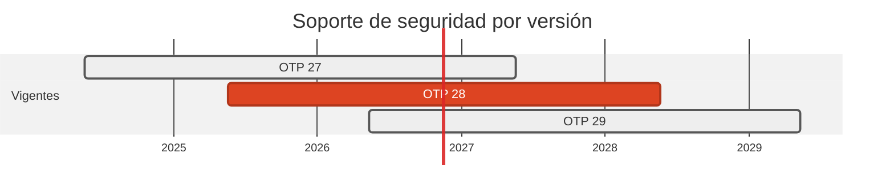

# 💜 Erlang/OTP 27 → 28 · Elixir 1.17 → 1.18

> Sin urgencia en la máquina virtual, pero `cowboy` arrastraba tres advisories, uno de ellos HIGH.

[← Volver al índice de actualizaciones](../VERSION_UPGRADES.md) · [README](../../README.md)

---

## Resumen

| | |
| :--- | :--- |
| **Casos afectados** | 1 (11) |
| **Cambios de versión registrados** | 2 |
| **Advisories cerrados en dependencias de este stack** | 3 |
| **Riesgo de ruptura** | Bajo |

## Ventanas de soporte

| Versión | Publicada | Fin de soporte | Estado |
| :--- | :--- | :--- | :--- |
| `OTP 27` | 2024-05-20 | 2027-05-20 | con soporte |
| `OTP 28` | 2025-05-20 | 2028-05-20 | **adoptada** |
| `OTP 29` | 2026-05-11 | 2029-05-11 | última |

## Por qué se cambió

- OTP 27 aun tiene soporte hasta 2027: el salto a 28 es margen, no urgencia.

- Emisor y receptor se mueven juntos para que compartan la misma OTP: el emisor pasa a `elixir:1.18-otp-28-alpine`. El código usa el módulo `:json` de OTP, disponible desde la 27.

- Lo que si era urgente es `cowboy` 2.12.0 → 2.20.0, el servidor HTTP del receptor: acumulacion de buffer sin límite al parsear cabeceras multipart (`CVE-2026-8466`, HIGH), bypass de `max_headers` con nombres duplicados (`CVE-2026-65624`) y HTTP request/response splitting (`CVE-2026-43966`).

## Implementación — dónde quedó escrito cada cambio

Las rutas de esta tabla las verifica `scripts/validate_security_manifests.py` en CI: si alguna no existe, el pipeline falla.

| Caso | Componente | De | A | Motivo | Fichero y mecanismo |
| :--- | :--- | :--- | :--- | :--- | :--- |
| 11 | origin | `1.17-otp-27-alpine` | `1.18-otp-28-alpine` | `mantenimiento` | `cases/11-elixir-to-erlang/origin/Dockerfile` (FROM de la imagen) |
| 11 | dest | `27-alpine` | `28-alpine` | `mantenimiento` | `cases/11-elixir-to-erlang/dest/Dockerfile` (FROM de la imagen); `cases/11-elixir-to-erlang/origin/Dockerfile` (FROM de la imagen) |

## Dependencias de este stack

| Caso | Paquete | De | A | Severidad | Advisories | Fichero y mecanismo |
| :--- | :--- | :--- | :--- | :--- | :--- | :--- |
| 11 | `cowboy` | `2.12.0` | `2.20.0` | HIGH | CVE-2026-8466, CVE-2026-65624, CVE-2026-43966 | `cases/11-elixir-to-erlang/dest/rebar.config` (deps de rebar3) |

## Riesgo y verificación

Bajo. El receptor es Cowboy + Mnesia embebida; el emisor usa `:httpc`. Ninguno de los dos se compila en el pipeline: solo dentro de su imagen Docker, que **no se construyo** en este pase.

## Fuentes

- <https://endoflife.date/erlang>
- <https://endoflife.date/elixir>
