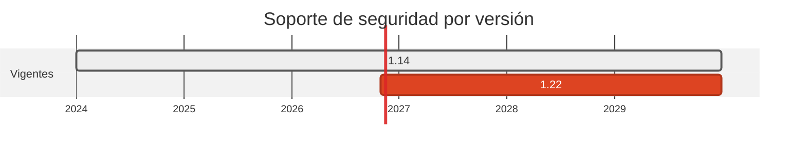

# 💠 Crystal 1.14 → 1.22

> Ocho versiones menores de retraso. Sin CVE, pero con el framework web del caso anclado a una rama vieja.

[← Volver al índice de actualizaciones](../VERSION_UPGRADES.md) · [README](../../README.md)

---

## Resumen

| | |
| :--- | :--- |
| **Casos afectados** | 1 (18) |
| **Cambios de versión registrados** | 1 |
| **Advisories cerrados en dependencias de este stack** | 0 |
| **Riesgo de ruptura** | **El mas alto del pase |

## Ventanas de soporte

| Versión | Publicada | Fin de soporte | Estado |
| :--- | :--- | :--- | :--- |
| `1.14` | 2024-10-? | sin EOL formal | 8 menores atrás |
| `1.22` | 2026-10-30 | última estable | **adoptada** |

## Por qué se cambió

- Crystal no publica ventanas de soporte: solo hay una última estable.

- El motor del cambio es `kemal`, el framework del receptor: la 1.15.0 exige `crystal >= 1.12.0`, así que el `shard.yml` sube de `~> 1.6.0` a `~> 1.15.0` y el requisito declarado de Crystal pasa de `>= 1.10.0` a `>= 1.12.0`.

## Implementación — dónde quedó escrito cada cambio

Las rutas de esta tabla las verifica `scripts/validate_security_manifests.py` en CI: si alguna no existe, el pipeline falla.

| Caso | Componente | De | A | Motivo | Fichero y mecanismo |
| :--- | :--- | :--- | :--- | :--- | :--- |
| 18 | dest | `1.14-alpine` | `1.22-alpine` | `mantenimiento` | `cases/18-zig-to-crystal/dest/Dockerfile` (FROM de la imagen) |

## Dependencias de este stack

| Caso | Paquete | De | A | Severidad | Advisories | Fichero y mecanismo |
| :--- | :--- | :--- | :--- | :--- | :--- | :--- |
| 18 | `kemal` | `~> 1.6.0` | `~> 1.15.0` | - | — | `cases/18-zig-to-crystal/dest/shard.yml` (`dependencies.kemal.version`, linea 11) |

## Riesgo y verificación

**El mas alto del pase.** Es un salto de ocho menores en un lenguaje pre-1.0 en lo que respecta a estabilidad de librerias, y no hay compilador Crystal en la máquina ni en el pipeline: el caso solo se compila dentro de su imagen Docker, que no se construyo. Es el primer sitio donde mirar si el build falla.

## Fuentes

- <https://crystal-lang.org/releases/>
- <https://github.com/kemalcr/kemal>
