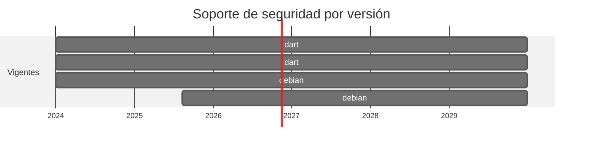

# 🎯 Dart y Debian: fuera los tags flotantes

> `dart:stable` y `debian:stable-slim` no son versiones: son punteros moviles. El build no era reproducible.

[← Volver al índice de actualizaciones](../VERSION_UPGRADES.md) · [README](../../README.md)

---

## Resumen

| | |
| :--- | :--- |
| **Casos afectados** | 1 (20) |
| **Cambios de versión registrados** | 2 |
| **Advisories cerrados en dependencias de este stack** | 0 |
| **Riesgo de ruptura** | Bajo, y de hecho **reduce** riesgo: a partir de ahora el build es reproducible |

## Ventanas de soporte

| Versión | Publicada | Fin de soporte | Estado |
| :--- | :--- | :--- | :--- |
| `dart:stable` | — | tag movil | **eliminado** |
| `dart:3.10-sdk` | 2026-? | rama fijada | **adoptada** |
| `debian:stable-slim` | — | tag movil | **eliminado** |
| `debian:13-slim` | 2025-08-09 | trixie, estable | **adoptada** |

## Por qué se cambió

- Un tag movil hace que **la misma linea de `Dockerfile` produzca imagenes distintas** según el día. Dos builds del mismo commit no son comparables, y un fallo nuevo no se puede atribuir a un cambio del repositorio.

- Ademas deja ciego al guardrail: `check_runtime_security.py` rechaza `:latest`, pero `stable` es exactamente el mismo problema con otro nombre, y no habia nada concreto que comprobar.

- El `pubspec.yaml` declara `sdk: >=3.5.0 <4.0.0`, que `dart:3.10-sdk` cumple. `debian:13-slim` es trixie, la estable actual.

## Implementación — dónde quedó escrito cada cambio

Las rutas de esta tabla las verifica `scripts/validate_security_manifests.py` en CI: si alguna no existe, el pipeline falla.

| Caso | Componente | De | A | Motivo | Fichero y mecanismo |
| :--- | :--- | :--- | :--- | :--- | :--- |
| 20 | dest | `dart:stable` | `dart:3.10-sdk` | `endurecimiento` | `cases/20-swift-to-dart/dest/Dockerfile` (FROM de la imagen) |
| 20 | dest | `debian:stable-slim` | `debian:13-slim` | `endurecimiento` | `cases/20-swift-to-dart/dest/Dockerfile` (FROM de la imagen) |

## Dependencias de este stack

| Caso | Paquete | De | A | Severidad | Advisories | Fichero y mecanismo |
| :--- | :--- | :--- | :--- | :--- | :--- | :--- |
| 20 | `shelf` | `^1.4.2` | `^1.4.3` | - | — | `cases/20-swift-to-dart/dest/pubspec.yaml` (dependencia de pub) |
| 20 | `shelf_router` | `^1.1.4` | `^1.1.5` | - | — | `cases/20-swift-to-dart/dest/pubspec.yaml` (dependencia de pub) |
| 20 | `http` | `^1.2.2` | `^1.6.0` | - | — | `cases/20-swift-to-dart/dest/pubspec.yaml` (dependencia de pub) |

## Riesgo y verificación

Bajo, y de hecho **reduce** riesgo: a partir de ahora el build es reproducible. No se compila en el pipeline.

## Fuentes

- <https://hub.docker.com/_/dart>
- <https://www.debian.org/releases/>
