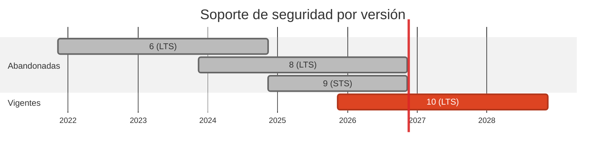

# 🟦 .NET 6 / 9 → 10 (LTS)

> El caso 08 llevaba **dos años** sobre un runtime sin parches, y el caso 19 estaba a nueve días de quedarse igual.

[← Volver al índice de actualizaciones](../VERSION_UPGRADES.md) · [README](../../README.md)

---

## Resumen

| | |
| :--- | :--- |
| **Casos afectados** | 2 (08, 19) |
| **Cambios de versión registrados** | 2 |
| **Advisories cerrados en dependencias de este stack** | 0 |
| **Riesgo de ruptura** | Medio |

## Ventanas de soporte

| Versión | Publicada | Fin de soporte | Estado |
| :--- | :--- | :--- | :--- |
| `6 (LTS)` | 2021-11-08 | 2024-11-12 | **EOL hace 2 años** |
| `8 (LTS)` | 2023-11-14 | 2026-11-10 | EOL en días |
| `9 (STS)` | 2024-11-12 | 2026-11-10 | **EOL en días**, no es LTS |
| `10 (LTS)` | 2025-11-11 | 2028-11-14 | **adoptada** |

## Por qué se cambió

- El `TargetFramework` del caso 08 era `net6.0`: EOL el 2024-11-12. Dos años sin un solo parche de runtime.

- El caso 19 estaba en `net9.0`, que **no es LTS** y cuyo EOL es el 2026-11-10. Subirlo a 9 otra vez habría sido trabajo tirado.

- .NET alterna LTS (impares... en realidad pares: 6, 8, 10) y STS. Ir a **10** da soporte hasta 2028-11-14 y evita volver a tocar esto en un año.

## Implementación — dónde quedó escrito cada cambio

Las rutas de esta tabla las verifica `scripts/validate_security_manifests.py` en CI: si alguna no existe, el pipeline falla.

| Caso | Componente | De | A | Motivo | Fichero y mecanismo |
| :--- | :--- | :--- | :--- | :--- | :--- |
| 08 | origin | `net6.0` | `net10.0` | `eol` | `cases/08-csharp-to-flask/origin/SocialBot.csproj` (TargetFramework) |
| 19 | origin | `9.0 (sdk/runtime, net9.0)` | `10.0 (sdk/runtime, net10.0)` | `eol` | `cases/19-fsharp-to-clojure/origin/Dockerfile` (FROM de la imagen); `cases/19-fsharp-to-clojure/origin/Publisher.fsproj` (TargetFramework) |

## Riesgo y verificación

Medio. Es el salto de mas majors del pase (6 → 10). El emisor del caso 08 es una consola con `HttpClient` y el del 19 un publicador F#, ambos sin API retirada conocida. El job `Dotnet Origin (08)` compila sobre el SDK 10 y pasa; el caso 19 solo se compila dentro de su imagen Docker, que **no se construyo** en este pase.

## Fuentes

- <https://endoflife.date/dotnet>
- <https://dotnet.microsoft.com/platform/support/policy>
