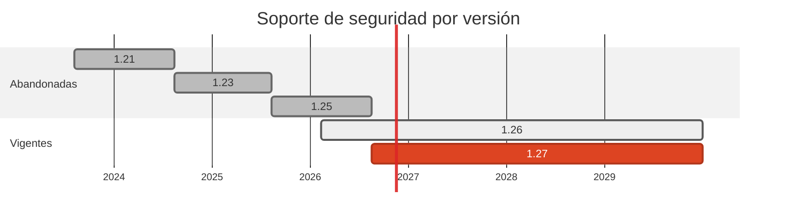

# 🐹 Go 1.21 / 1.23 → 1.27

> El cambio de mayor impacto del pase: dos ramas en EOL con 72 y 59 advisories de la biblioteca estándar.

[← Volver al índice de actualizaciones](../VERSION_UPGRADES.md) · [README](../../README.md)

---

## Resumen

| | |
| :--- | :--- |
| **Casos afectados** | 5 (02, 03, 06, 13, 15) |
| **Cambios de versión registrados** | 5 |
| **Advisories cerrados en dependencias de este stack** | 12 |
| **Riesgo de ruptura** | Bajo |

## Ventanas de soporte

| Versión | Publicada | Fin de soporte | Estado |
| :--- | :--- | :--- | :--- |
| `1.21` | 2023-08-08 | 2024-08-13 | EOL hace mas de 2 años |
| `1.23` | 2024-08-13 | 2025-08-12 | EOL hace mas de 1 año |
| `1.25` | 2025-08-12 | 2026-08-19 | EOL |
| `1.26` | 2026-02-10 | con soporte | soportada |
| `1.27` | 2026-08-19 | con soporte | **adoptada** |

## Por qué se cambió

- Go mantiene **solo las dos ramas mas recientes**. Cuando sale 1.27, la 1.25 deja de recibir parches: no hay backports y no hay versión "estable antigua".

- Esto hace que una rama EOL no acumule *un* CVE, sino **todos** los de la stdlib publicados desde su último parche. OSV reporta **72 advisories** para `stdlib` 1.21.13 y **59** para 1.23.12.

- Entre ellos hay fallos explotables en remoto sin autenticación: request smuggling por aceptar chunked inválido (`CVE-2025-22871`), cabeceras sensibles no limpiadas al redirigir cross-origin (`CVE-2025-4673`, `CVE-2024-45336`) y resultados incorrectos en `database/sql` (`CVE-2025-47907`).

## Implementación — dónde quedó escrito cada cambio

Las rutas de esta tabla las verifica `scripts/validate_security_manifests.py` en CI: si alguna no existe, el pipeline falla.

| Caso | Componente | De | A | Motivo | Fichero y mecanismo |
| :--- | :--- | :--- | :--- | :--- | :--- |
| 02 | dest | `1.21-alpine` | `1.27-alpine` | `eol` | `cases/02-python-to-go/dest/Dockerfile` (FROM de la imagen) |
| 03 | origin | `1.21 (go.mod)` | `1.27 (go.mod)` | `eol` | `cases/03-go-to-node/origin/go.mod` (directiva go / require) |
| 06 | origin | `1.21 (go.mod)` | `1.27 (go.mod)` | `eol` | `cases/06-go-to-symfony/origin/go.mod` (directiva go / require) |
| 13 | dest | `1.23-alpine` | `1.27-alpine` | `eol` | `cases/13-node-to-go-kafka/dest/Dockerfile` (FROM de la imagen) |
| 15 | origin | `1.23-alpine` | `1.27-alpine` | `eol` | `cases/15-grpc-go-to-python/origin/Dockerfile` (FROM de la imagen) |

## Dependencias de este stack

| Caso | Paquete | De | A | Severidad | Advisories | Fichero y mecanismo |
| :--- | :--- | :--- | :--- | :--- | :--- | :--- |
| 02 | `stdlib` | `1.21.13` | `1.27.3` | HIGH | CVE-2025-22871, CVE-2025-4673, CVE-2025-47907, CVE-2024-45336, CVE-2024-45341, CVE-2025-0913 | `cases/02-python-to-go/dest/go.mod` (directiva `go 1.27`); `cases/02-python-to-go/dest/Dockerfile` (FROM golang:1.27-alpine). La stdlib no es una linea de `require`: su version la fija el toolchain. |
| 02 | `github.com/go-sql-driver/mysql` | `v1.8.1` | `v1.10.1` | - | — | `cases/02-python-to-go/dest/go.mod` (directiva go / require) |
| 02 | `filippo.io/edwards25519` | `v1.1.0` | `v1.2.0` | - | — | `cases/02-python-to-go/dest/go.mod` (directiva go / require) |
| 13 | `stdlib` | `1.23.12` | `1.27.3` | HIGH | CVE-2025-47907, CVE-2025-47906, CVE-2026-97032 | `cases/13-node-to-go-kafka/dest/go.mod` (directiva `go 1.27`); `cases/13-node-to-go-kafka/dest/Dockerfile` (FROM golang:1.27-alpine). La stdlib no es una linea de `require`: su version la fija el toolchain. |
| 13 | `github.com/segmentio/kafka-go` | `v0.4.47` | `v0.4.51` | - | — | `cases/13-node-to-go-kafka/dest/go.mod` (directiva go / require) |
| 15 | `google.golang.org/grpc` | `v1.67.1` | `v1.85.0` | CRITICAL | CVE-2026-33186, CVE-2026-84304, CVE-2026-84445, CVE-2026-84303 | `cases/15-grpc-go-to-python/origin/go.mod` (directiva go / require) |
| 15 | `google.golang.org/protobuf` | `v1.35.1` | `v1.36.12` | - | — | `cases/15-grpc-go-to-python/origin/Dockerfile` (FROM de la imagen); `cases/15-grpc-go-to-python/origin/go.mod` (directiva go / require) |
| 15 | `github.com/lib/pq` | `v1.10.9` | `v1.12.3` | - | — | `cases/15-grpc-go-to-python/origin/go.mod` (directiva go / require) |
| 15 | `stdlib` | `1.23.12` | `1.27.3` | HIGH | CVE-2025-47907, CVE-2025-47906 | `cases/15-grpc-go-to-python/origin/go.mod` (directiva `go 1.27`); `cases/15-grpc-go-to-python/origin/Dockerfile` (FROM golang:1.27-alpine). La stdlib no es una linea de `require`: su version la fija el toolchain. |

## Riesgo y verificación

Bajo. El código de los casos usa `net/http`, `database/sql` y drivers estándar; no hay API retirada entre 1.21 y 1.27 que afecte a este laboratorio. El job `Go Cases (02,03,06)` del pipeline compila los tres casos y corre `govulncheck`, y pasó en verde.

## Fuentes

- <https://endoflife.date/go>
- <https://go.dev/doc/devel/release>
