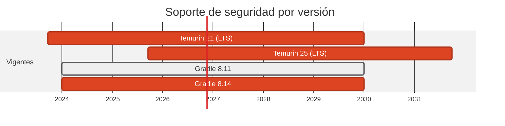

# ☕ JVM: Temurin 21 se queda, Gradle 8.11 → 8.14

> El único apartado donde la decision correcta fue **no** subir el runtime. Lo que si estaba vulnerable eran las librerias.

[← Volver al índice de actualizaciones](../VERSION_UPGRADES.md) · [README](../../README.md)

---

## Resumen

| | |
| :--- | :--- |
| **Casos afectados** | 3 (10, 19, 20) |
| **Cambios de versión registrados** | 4 |
| **Advisories cerrados en dependencias de este stack** | 13 |
| **Riesgo de ruptura** | Bajo |

## Ventanas de soporte

| Versión | Publicada | Fin de soporte | Estado |
| :--- | :--- | :--- | :--- |
| `Temurin 21 (LTS)` | 2023-09-19 | 2029-12-31 | **se mantiene** |
| `Temurin 25 (LTS)` | 2025-09-16 | 2031-09-30 | no adoptada |
| `Gradle 8.11` | 2024-11-? | — | última 8.x: 8.14 |
| `Gradle 8.14` | 2025-? | — | **adoptada** |

## Por qué se cambió

- Java 21 es LTS con soporte hasta **2029-12-31** y el tag `21-jre-alpine` ya trae el último parche. Subir a 25 no cerraria ningun advisory y obligaria a Gradle 9 y a revisar el toolchain de Kotlin: coste sin beneficio de seguridad.

- Gradle sube al último parche de la linea 8.x, compatible con el plugin de Spring Boot 3.5.

- La imagen del emulador de Firestore (caso 20) pasa de `21-jdk-jammy` a `21-jdk-noble`: Ubuntu 22.04 → 24.04 LTS, mas margen de parches de OS.

## Dónde estaba el riesgo de verdad

Tres cadenas de dependencias JVM arrastraban advisories abiertos, y ninguna se arregla subiendo la JVM:

**Spring Boot 3.3.5 → 3.5.16** (caso 10, emisor). La rama 3.3 salió del soporte OSS. Pero el problema de fondo es que **Spring Boot 3.5.16 gestiona `jackson-bom` 2.21.4**, que arrastra `jackson-databind` con **9 advisories abiertos**. Subir Boot no basta: hay que pisar la propiedad del BOM con `ext["jackson-bom.versión"] = "2.21.8"`, que reemplaza toda la familia Jackson de una vez.

**pgjdbc 42.7.4 → 42.7.12** (caso 10, receptor). Tres advisories HIGH de autenticación: fallback a autenticación insegura **aunque se pida `channelBinding=require`** (`CVE-2025-49146`), iteraciones PBKDF2 sin límite en SCRAM (`CVE-2026-42198`) y downgrade silencioso del channel binding (`CVE-2026-54291`).

**ring 1.12.2 → 1.15.6** (caso 19). `ring-jetty-adapter` 1.12.2 fija **Jetty 11**, con tres advisories abiertos. La 1.15.6 pasa a Jetty 12.1.14, por encima del piso de los cinco. Y `cheshire` 6.2.0 fija `jackson-core` 2.21.1, por debajo del piso 2.21.7: se añade `jackson-core` 2.21.8 como **dependencia directa** del `project.clj` para pisar la transitiva.

**Ktor 2.3.13 se mantiene**: no tiene advisory abierto, y Ktor 3.x cambia la API (migracion a `kotlinx-io`). Subir de major sin un fallo que lo justifique es cambio por el cambio.

## Implementación — dónde quedó escrito cada cambio

Las rutas de esta tabla las verifica `scripts/validate_security_manifests.py` en CI: si alguna no existe, el pipeline falla.

| Caso | Componente | De | A | Motivo | Fichero y mecanismo |
| :--- | :--- | :--- | :--- | :--- | :--- |
| 10 | origin+dest | `8.11-jdk21` | `8.14-jdk21` | `mantenimiento` | `cases/10-java-to-kotlin/dest/Dockerfile` (FROM de la imagen); `cases/10-java-to-kotlin/origin/Dockerfile` (FROM de la imagen) |
| 10 | origin+dest | `eclipse-temurin:21-jre-alpine` | `sin cambio` | `sin-cambio` | (sin cambio: no se toco ningun fichero) |
| 19 | dest | `clojure:temurin-21-lein + temurin:21-jre-alpine` | `sin cambio` | `sin-cambio` | (sin cambio: no se toco ningun fichero) |
| 20 | firebase | `eclipse-temurin:21-jdk-jammy` | `eclipse-temurin:21-jdk-noble` | `mantenimiento` | `cases/20-swift-to-dart/firebase/Dockerfile` (FROM de la imagen) |

## Dependencias de este stack

| Caso | Paquete | De | A | Severidad | Advisories | Fichero y mecanismo |
| :--- | :--- | :--- | :--- | :--- | :--- | :--- |
| 10 | `org.springframework.boot` | `3.3.5` | `3.5.16` | - | — | `cases/10-java-to-kotlin/origin/build.gradle.kts` (dependencia Gradle) |
| 10 | `com.fasterxml.jackson:jackson-bom` | `2.21.4 (gestionada por Boot)` | `2.21.8 (ext["jackson-bom.version"])` | HIGH | GHSA-5gvw-p9qm-jgwh, CVE-2026-89425, CVE-2026-89407, CVE-2026-68494 | `cases/10-java-to-kotlin/origin/build.gradle.kts` (dependencia Gradle) |
| 10 | `org.postgresql:postgresql` | `42.7.4` | `42.7.14` | HIGH | CVE-2025-49146, CVE-2026-42198, CVE-2026-54291 | `cases/10-java-to-kotlin/dest/build.gradle.kts` (dependencia Gradle) |
| 10 | `ch.qos.logback:logback-classic` | `1.5.12` | `1.5.38` | - | — | `cases/10-java-to-kotlin/dest/build.gradle.kts` (dependencia Gradle) |
| 10 | `io.ktor` | `2.3.13` | `2.3.13` | - | — | `cases/10-java-to-kotlin/dest/build.gradle.kts` (`val ktorVersion = "2.3.13"`, linea 16) |
| 19 | `ring/ring-core` | `1.12.2` | `1.15.6` | - | — | `cases/19-fsharp-to-clojure/dest/project.clj` (dependencia Leiningen) |
| 19 | `ring/ring-jetty-adapter` | `1.12.2` | `1.15.6` | HIGH | CVE-2024-7708, CVE-2024-8184, CVE-2026-6790, CVE-2026-1605, CVE-2026-10051 | `cases/19-fsharp-to-clojure/dest/project.clj` (dependencia Leiningen) |
| 19 | `cheshire/cheshire` | `5.13.0` | `6.2.0` | - | — | `cases/19-fsharp-to-clojure/dest/project.clj` (dependencia Leiningen) |
| 19 | `com.fasterxml.jackson.core:jackson-core` | `2.21.1 (transitiva)` | `2.21.8 (pin directo)` | HIGH | CVE-2026-89425, CVE-2026-89407, CVE-2026-68494, CVE-2026-18401 | `cases/19-fsharp-to-clojure/dest/project.clj` (dependencia Leiningen) |
| 19 | `org.clojure/clojure` | `1.11.4` | `1.12.0` | - | — | `cases/19-fsharp-to-clojure/dest/project.clj` (dependencia Leiningen) |
| 19 | `com.xtdb/xtdb-core` | `1.24.3` | `1.24.3` | - | — | `cases/19-fsharp-to-clojure/dest/project.clj` (dependencia Leiningen) |

## Riesgo y verificación

Bajo. Pero ver el apartado siguiente: aquí el riesgo no estaba en el runtime.

## Fuentes

- <https://endoflife.date/eclipse-temurin>
- <https://gradle.org/releases/>
