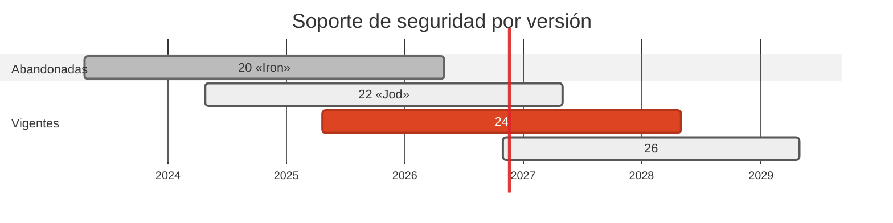

# 🟩 Node.js 20 → 24 LTS

> Node 20 dejó de recibir parches el 2026-04-30. Su último release de seguridad fue el 20.20.2, de marzo de 2026.

[← Volver al índice de actualizaciones](../VERSION_UPGRADES.md) · [README](../../README.md)

---

## Resumen

| | |
| :--- | :--- |
| **Casos afectados** | 7 (03, 04, 05, 13, 14, 16, 17) |
| **Cambios de versión registrados** | 7 |
| **Advisories cerrados en dependencias de este stack** | 31 |
| **Riesgo de ruptura** | Bajo |

## Ventanas de soporte

| Versión | Publicada | Fin de soporte | Estado |
| :--- | :--- | :--- | :--- |
| `20 «Iron»` | 2023-04-18 | 2026-04-30 | **EOL** |
| `22 «Jod»` | 2024-04-24 | 2027-04-30 | Maintenance LTS |
| `24` | 2025-04-22 | 2028-04-30 | **adoptada** (LTS) |
| `26` | 2026-10-28 | 2029-04-30 | Current → LTS |

## Por qué se cambió

- La rama 20 quedó fuera del calendario de releases de seguridad: el del 2026-07 ya solo cubrio 22.x, 24.x y 26.x.

- Subir a 24 tiene un segundo efecto, deliberado: **pnpm 11 exige Node >= 22.13** (usa `node:sqlite`). Con Node 20 el laboratorio estaba atascado en pnpm 10 y no podia activar las defensas de supply-chain de pnpm 11.

- Se elige 24 y no 26 porque 24 ya esta en LTS con soporte hasta 2028, mientras 26 acaba de entrar: para un laboratorio que se reproduce en máquinas ajenas, la rama rodada vale mas que la recien salida.

## Implementación — dónde quedó escrito cada cambio

Las rutas de esta tabla las verifica `scripts/validate_security_manifests.py` en CI: si alguna no existe, el pipeline falla.

| Caso | Componente | De | A | Motivo | Fichero y mecanismo |
| :--- | :--- | :--- | :--- | :--- | :--- |
| 03 | dest | `20-alpine` | `24-alpine` | `eol` | `cases/03-go-to-node/dest/Dockerfile` (FROM de la imagen); `docker-compose.yml` (image del servicio) |
| 04 | origin | `20-alpine` | `24-alpine` | `eol` | `docker-compose.yml` (image del servicio) |
| 05 | dest | `20-alpine` | `24-alpine` | `eol` | `docker-compose.yml` (image del servicio) |
| 13 | origin | `20-alpine` | `24-alpine` | `eol` | `cases/13-node-to-go-kafka/origin/Dockerfile` (FROM de la imagen); `docker-compose.yml` (image del servicio) |
| 14 | origin+dest | `20-alpine` | `24-alpine` | `eol` | `cases/14-nextjs-to-supabase/dest/Dockerfile` (FROM de la imagen); `cases/14-nextjs-to-supabase/origin/Dockerfile` (FROM de la imagen); `docker-compose.yml` (image del servicio) |
| 16 | origin+dest | `20-alpine` | `24-alpine` | `eol` | `cases/16-graphql-to-hasura/dest/receiver/Dockerfile` (FROM de la imagen); `cases/16-graphql-to-hasura/origin/Dockerfile` (FROM de la imagen); `docker-compose.yml` (image del servicio) |
| 17 | dest | `20-alpine` | `24-alpine` | `eol` | `cases/17-mqtt-rust-to-node/dest/Dockerfile` (FROM de la imagen); `docker-compose.yml` (image del servicio) |

## Dependencias de este stack

| Caso | Paquete | De | A | Severidad | Advisories | Fichero y mecanismo |
| :--- | :--- | :--- | :--- | :--- | :--- | :--- |
| 03 | `express` | `^4.18.2` | `^4.22.3` | MODERATE | CVE-2024-43796, CVE-2024-29041 | `cases/03-go-to-node/dest/package.json` (dependencias / packageManager) |
| 03 | `axios` | `^1.18.0` | `^1.21.0` | HIGH | CVE-2026-101898, CVE-2026-101901, CVE-2026-101903, CVE-2026-101905, CVE-2026-101906, CVE-2026-101907 | `cases/03-go-to-node/dest/package.json` (dependencias / packageManager) |
| 03 | `pg` | `^8.11.3` | `^8.23.1` | - | — | `cases/03-go-to-node/dest/package.json` (dependencias / packageManager) |
| 03 | `proxy-addr` | `transitiva < 2.0.8` | `override >=2.0.8` | CRITICAL | GHSA-jqcg-44mw-7w3h | `cases/03-go-to-node/dest/pnpm-workspace.yaml` (override de pnpm) |
| 03 | `body-parser` | `transitiva < 1.20.9` | `override >=1.20.9 <2.0.0` | HIGH | GHSA-27r3-jxmh-p828, GHSA-v422-hmwv-36x6 | `cases/03-go-to-node/dest/pnpm-workspace.yaml` (override de pnpm) |
| 03 | `qs` | `transitiva <= 6.16.0` | `override >=6.16.1 <7.0.0` | MODERATE | GHSA-4mjr-xmp4-gh2g, GHSA-x5fp-wj9c-mxmx, GHSA-6pq8-jhm2-2vcw | `cases/03-go-to-node/dest/pnpm-workspace.yaml` (override de pnpm) |
| 03 | `follow-redirects` | `transitiva <= 1.16.1` | `override >=1.16.2` | HIGH | GHSA-mrwp-f3q8-3g9p, GHSA-q3jh-wrc6-jgq8, GHSA-8r9p-f939-6h3c | `cases/03-go-to-node/dest/pnpm-workspace.yaml` (override de pnpm) |
| 03 | `form-data` | `override >=4.0.6` | `override >=4.0.6` | CRITICAL | CVE-2025-7783 | `cases/03-go-to-node/dest/pnpm-workspace.yaml` (override de pnpm) |
| 04 | `axios` | `^1.18.0` | `^1.21.0` | HIGH | CVE-2026-101898, CVE-2026-101901, CVE-2026-101903, CVE-2026-101905, CVE-2026-101906, CVE-2026-101907 | `cases/04-node-to-fastapi/origin/package.json` (dependencias / packageManager) |
| 04 | `follow-redirects` | `transitiva <= 1.16.1` | `override >=1.16.2` | HIGH | GHSA-mrwp-f3q8-3g9p, GHSA-q3jh-wrc6-jgq8, GHSA-8r9p-f939-6h3c | `cases/04-node-to-fastapi/origin/pnpm-workspace.yaml` (override de pnpm) |
| 05 | `express` | `^4.22.1` | `^4.22.3` | - | — | `cases/05-laravel-to-react/dest/package.json` (dependencias / packageManager) |
| 05 | `mongodb` | `^6.3.0` | `^6.21.0` | - | — | `cases/05-laravel-to-react/dest/package.json` (dependencias / packageManager) |
| 05 | `proxy-addr` | `transitiva < 2.0.8` | `override >=2.0.8` | CRITICAL | GHSA-jqcg-44mw-7w3h | `cases/05-laravel-to-react/dest/pnpm-workspace.yaml` (override de pnpm) |
| 05 | `body-parser` | `transitiva < 1.20.9` | `override >=1.20.9 <2.0.0` | HIGH | GHSA-27r3-jxmh-p828, GHSA-v422-hmwv-36x6 | `cases/05-laravel-to-react/dest/pnpm-workspace.yaml` (override de pnpm) |
| 05 | `qs` | `override >=6.15.2 <7.0.0` | `override >=6.16.1 <7.0.0` | MODERATE | GHSA-4mjr-xmp4-gh2g, GHSA-x5fp-wj9c-mxmx, GHSA-6pq8-jhm2-2vcw | `cases/05-laravel-to-react/dest/pnpm-workspace.yaml` (override de pnpm) |
| 05 | `path-to-regexp` | `override >=0.1.13 <0.2.0` | `override >=0.1.13 <0.2.0` | HIGH | GHSA-37ch-88jc-xwx2 | `cases/05-laravel-to-react/dest/pnpm-workspace.yaml` (override de pnpm) |
| 13 | `kafkajs` | `2.2.4` | `2.2.4` | - | — | `cases/13-node-to-go-kafka/origin/package.json` (dependencias / packageManager) |
| 14 | `next` | `15.1.3` | `15.5.28` | CRITICAL | GHSA-2464-fhr4-w9xw, GHSA-2xp9-vwfh-vxw4, CVE-2026-44573, CVE-2025-49826, CVE-2026-64649, GHSA-8h8q-6873-q5fj | `cases/14-nextjs-to-supabase/origin/package.json` (dependencias / packageManager) |
| 14 | `postcss` | `transitiva <= 8.5.22` | `override >=8.5.23` | HIGH | GHSA-6g55-p6wh-862q, GHSA-r28c-9q8g-f849, GHSA-fxqj-rqcc-2cmp, GHSA-qx2v-qp2m-jg93 | `cases/14-nextjs-to-supabase/origin/pnpm-workspace.yaml` (override de pnpm) |
| 14 | `react` | `19.0.0` | `19.3.1` | - | — | `cases/14-nextjs-to-supabase/origin/package.json` (dependencias / packageManager) |
| 14 | `react-dom` | `19.0.0` | `19.3.1` | - | — | `cases/14-nextjs-to-supabase/origin/package.json` (dependencias / packageManager) |
| 14 | `express` | `4.21.2` | `4.22.3` | - | — | `cases/14-nextjs-to-supabase/dest/package.json` (dependencias / packageManager) |
| 14 | `proxy-addr` | `transitiva < 2.0.8` | `override >=2.0.8` | CRITICAL | GHSA-jqcg-44mw-7w3h | `cases/14-nextjs-to-supabase/dest/pnpm-workspace.yaml` (override de pnpm) |
| 14 | `body-parser` | `transitiva < 1.20.9` | `override >=1.20.9 <2.0.0` | HIGH | GHSA-27r3-jxmh-p828, GHSA-v422-hmwv-36x6 | `cases/14-nextjs-to-supabase/dest/pnpm-workspace.yaml` (override de pnpm) |
| 14 | `qs` | `transitiva <= 6.16.0` | `override >=6.16.1 <7.0.0` | MODERATE | GHSA-4mjr-xmp4-gh2g, GHSA-x5fp-wj9c-mxmx, GHSA-6pq8-jhm2-2vcw | `cases/14-nextjs-to-supabase/dest/pnpm-workspace.yaml` (override de pnpm) |
| 16 | `@apollo/server` | `4.11.3` | `5.5.1` | HIGH | CVE-2026-23897, GHSA-9q82-xgwf-vj6h | `cases/16-graphql-to-hasura/origin/package.json` (dependencias / packageManager) |
| 16 | `graphql` | `16.10.0` | `16.14.2` | - | — | `cases/16-graphql-to-hasura/origin/package.json` (dependencias / packageManager) |
| 16 | `express` | `4.21.2` | `4.22.3` | - | — | `cases/16-graphql-to-hasura/dest/receiver/package.json` (dependencias / packageManager) |
| 16 | `proxy-addr` | `transitiva < 2.0.8` | `override >=2.0.8` | CRITICAL | GHSA-jqcg-44mw-7w3h | `cases/16-graphql-to-hasura/dest/receiver/pnpm-workspace.yaml` (override de pnpm) |
| 16 | `body-parser` | `transitiva < 1.20.9` | `override >=1.20.9 <2.0.0` | HIGH | GHSA-27r3-jxmh-p828, GHSA-v422-hmwv-36x6 | `cases/16-graphql-to-hasura/dest/receiver/pnpm-workspace.yaml` (override de pnpm) |
| 16 | `qs` | `transitiva <= 6.16.0` | `override >=6.16.1 <7.0.0` | MODERATE | GHSA-4mjr-xmp4-gh2g, GHSA-x5fp-wj9c-mxmx, GHSA-6pq8-jhm2-2vcw | `cases/16-graphql-to-hasura/dest/receiver/pnpm-workspace.yaml` (override de pnpm) |
| 17 | `mqtt` | `5.10.3` | `5.16.1` | - | — | `cases/17-mqtt-rust-to-node/dest/package.json` (dependencias / packageManager) |
| 17 | `express` | `4.21.2` | `4.22.3` | - | — | `cases/17-mqtt-rust-to-node/dest/package.json` (dependencias / packageManager) |
| 17 | `proxy-addr` | `transitiva < 2.0.8` | `override >=2.0.8` | CRITICAL | GHSA-jqcg-44mw-7w3h | `cases/17-mqtt-rust-to-node/dest/pnpm-workspace.yaml` (override de pnpm) |
| 17 | `body-parser` | `transitiva < 1.20.9` | `override >=1.20.9 <2.0.0` | HIGH | GHSA-27r3-jxmh-p828, GHSA-v422-hmwv-36x6 | `cases/17-mqtt-rust-to-node/dest/pnpm-workspace.yaml` (override de pnpm) |
| 17 | `qs` | `transitiva <= 6.16.0` | `override >=6.16.1 <7.0.0` | MODERATE | GHSA-4mjr-xmp4-gh2g, GHSA-x5fp-wj9c-mxmx, GHSA-6pq8-jhm2-2vcw | `cases/17-mqtt-rust-to-node/dest/pnpm-workspace.yaml` (override de pnpm) |

## Riesgo y verificación

Bajo. Los receptores usan `express`, `pg`, `mqtt` y APIs de `node:*` estables. El job `Node Cases` hace `node --check` de los 10 ficheros y `pnpm audit` de los 9 paquetes; verde en ambos.

## Fuentes

- <https://endoflife.date/nodejs>
- <https://github.com/nodejs/LTS>
