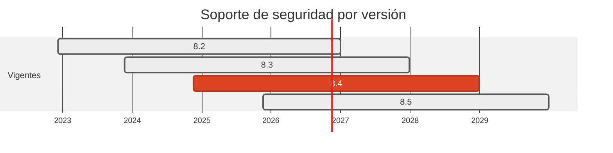

# 🐘 PHP 8.2 → 8.4

> El soporte activo de 8.2 cerro el 2024-12-31 y su EOL total es el 2026-12-31: quedaban ocho semanas.

[← Volver al índice de actualizaciones](../VERSION_UPGRADES.md) · [README](../../README.md)

---

## Resumen

| | |
| :--- | :--- |
| **Casos afectados** | 3 (01, 05, 06) |
| **Cambios de versión registrados** | 3 |
| **Advisories cerrados en dependencias de este stack** | 0 |
| **Riesgo de ruptura** | Bajo |

## Ventanas de soporte

| Versión | Publicada | Fin de soporte | Estado |
| :--- | :--- | :--- | :--- |
| `8.2` | 2022-12-08 | 2026-12-31 | **solo-seguridad, EOL inminente** |
| `8.3` | 2023-11-23 | 2027-12-31 | solo-seguridad |
| `8.4` | 2024-11-21 | 2028-12-31 | **adoptada** |
| `8.5` | 2025-11-20 | 2029-12-31 | recien salida |

## Por qué se cambió

- PHP da dos años de soporte activo y dos mas de solo-seguridad. La 8.2 estaba en el último tramo del segundo, con EOL el 2026-12-31.

- Se elige 8.4 y no 8.5 por disponibilidad de extensiones: el caso 06 instala `phpredis` por `pecl` sobre la imagen oficial, y la 8.4 lleva un año de rodaje con el ecosistema de extensiones al día.

## Implementación — dónde quedó escrito cada cambio

Las rutas de esta tabla las verifica `scripts/validate_security_manifests.py` en CI: si alguna no existe, el pipeline falla.

| Caso | Componente | De | A | Motivo | Fichero y mecanismo |
| :--- | :--- | :--- | :--- | :--- | :--- |
| 01 | dest | `8.2-apache` | `8.4-apache` | `fin-de-soporte` | `docker-compose.yml` (image del servicio) |
| 05 | origin | `8.2-apache` | `8.4-apache` | `fin-de-soporte` | `docker-compose.yml` (image del servicio) |
| 06 | dest | `8.2-apache` | `8.4-apache` | `fin-de-soporte` | `cases/06-go-to-symfony/dest/Dockerfile` (FROM de la imagen); `docker-compose.yml` (image del servicio) |

## Riesgo y verificación

Bajo. Los tres destinos PHP son scripts de dashboard con PDO y `phpredis`; no usan nada retirado en 8.3 ni 8.4. El job `PHP Cases (01,05,06)` hace `php -l` sobre PHP 8.4 y pasa.

## Fuentes

- <https://endoflife.date/php>
- <https://www.php.net/supported-versions.php>
