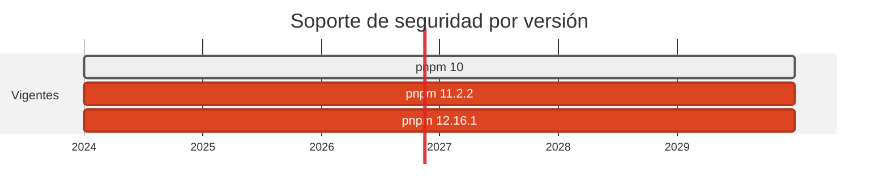

# 📦 pnpm 10 → 11: npm fuera del laboratorio

> Y la trampa mas peligrosa del pase: pnpm 11 **ya no lee** el campo `pnpm` de `package.json`.

[← Volver al índice de actualizaciones](../VERSION_UPGRADES.md) · [README](../../README.md)

---

## Resumen

| | |
| :--- | :--- |
| **Casos afectados** | 8 (03, 04, 05, 13, 14, 16, 17, 20) |
| **Cambios de versión registrados** | 8 |
| **Advisories cerrados en dependencias de este stack** | 0 |
| **Riesgo de ruptura** | Bajo en ejecucion, **alto si no se hubiera detectado la trampa** |

## Ventanas de soporte

| Versión | Publicada | Fin de soporte | Estado |
| :--- | :--- | :--- | :--- |
| `pnpm 10` | 2025-01-? | — | no lee Node >= 22.13 |
| `pnpm 11.2.2` | 2026-? | — | **adoptada** |
| `pnpm 12.16.1` | 2026-10-? | última | no adoptada: ver abajo |



## Por qué se cambió

- pnpm 11 trae las dos defensas que importan contra campañas tipo **Shai-Hulud**: los scripts de instalacion estan **bloqueados por defecto** y hay **cuarentena** configurable sobre versiones recien publicadas. El vector de esas campañas es justo un `postinstall` en un paquete recien comprometido.

- Exige Node >= 22.13, así que no se podia activar mientras el laboratorio estaba en Node 20. Los dos cambios van juntos.

- Se fija **11.2.2 y no 12.16.1** a propósito: 11.2.2 es la versión con la que se regeneraron y auditaron los 9 lockfiles en esta máquina. Fijar lo verificado vale mas que fijar lo último.

## La política que estuvo a punto de desactivarse en silencio

El repositorio protegia sus transitivas con `pnpm.overrides` dentro de `package.json`. **pnpm 11 ya no lee ese campo**: al actualizar, los `overrides` de seguridad y el `onlyBuiltDependencies` habrían quedado inertes sin un solo mensaje de error, y el lockfile se habría regenerado sin ellos.

Se detectó porque pnpm emite un `[WARN] The "pnpm" field in package.json is no longer read` — fácil de pasar por alto entre el ruido de un install. La política se traslado a un `pnpm-workspace.yaml` por paquete, y se **comprobó** que vuelve a aplicarse: el bloque `overrides:` reaparece en el lockfile resuelto.

```yaml
onlyBuiltDependencies: []   # ningun paquete ejecuta postinstall
minimumReleaseAge: 1440     # cuarentena de 24 h
overrides: ...              # pisos de versión por CVE
```

La prueba de que funciona llego sola: al instalar el caso 16, pnpm **bloqueó** el `postinstall` de `@apollo/protobufjs`.

## npm: cero invocaciones

`npm` ya no se ejecuta en ninguna superficie del repositorio:

| Donde | Antes | Ahora |
| :--- | :--- | :--- |
| `.github/workflows/ci-cd.yml` | `npm install -g pnpm@10` | `corepack enable && corepack prepare pnpm@11.2.2 --activate` |
| `.claude/settings.local.json` | `npx --yes pnpm@10 audit` | `pnpm audit` |
| `.gitignore` | solo `cases/*/dest/package-lock.json` | `package-lock.json`, `npm-shrinkwrap.json` y las tres rutas de casos |
| Dockerfiles Node | `pnpm install --prod` | `pnpm install --prod --frozen-lockfile` |

El ecosistema de Dependabot sigue llamandose `npm` porque es el nombre del **registro**, no del gestor: lee los `pnpm-lock.yaml` sin ejecutar npm.

## Implementación — dónde quedó escrito cada cambio

Las rutas de esta tabla las verifica `scripts/validate_security_manifests.py` en CI: si alguna no existe, el pipeline falla.

| Caso | Componente | De | A | Motivo | Fichero y mecanismo |
| :--- | :--- | :--- | :--- | :--- | :--- |
| 03 | dest | `10.0.0` | `11.2.2` | `endurecimiento` | `cases/03-go-to-node/dest/Dockerfile` (FROM de la imagen); `cases/03-go-to-node/dest/package.json` (dependencias / packageManager); `docker-compose.yml` (image del servicio) |
| 04 | origin | `10.0.0` | `11.2.2` | `endurecimiento` | `cases/04-node-to-fastapi/origin/package.json` (dependencias / packageManager); `docker-compose.yml` (image del servicio) |
| 05 | dest | `10.0.0` | `11.2.2` | `endurecimiento` | `cases/05-laravel-to-react/dest/package.json` (dependencias / packageManager); `docker-compose.yml` (image del servicio) |
| 13 | origin | `10.0.0` | `11.2.2` | `endurecimiento` | `cases/13-node-to-go-kafka/origin/Dockerfile` (FROM de la imagen); `cases/13-node-to-go-kafka/origin/package.json` (dependencias / packageManager); `docker-compose.yml` (image del servicio) |
| 14 | origin+dest | `10.0.0` | `11.2.2` | `endurecimiento` | `cases/14-nextjs-to-supabase/dest/Dockerfile` (FROM de la imagen); `cases/14-nextjs-to-supabase/dest/package.json` (dependencias / packageManager); `cases/14-nextjs-to-supabase/origin/Dockerfile` (FROM de la imagen) |
| 16 | origin+dest | `10.0.0` | `11.2.2` | `endurecimiento` | `cases/16-graphql-to-hasura/dest/receiver/Dockerfile` (FROM de la imagen); `cases/16-graphql-to-hasura/dest/receiver/package.json` (dependencias / packageManager); `cases/16-graphql-to-hasura/origin/Dockerfile` (FROM de la imagen) |
| 17 | dest | `10.0.0` | `11.2.2` | `endurecimiento` | `cases/17-mqtt-rust-to-node/dest/Dockerfile` (FROM de la imagen); `cases/17-mqtt-rust-to-node/dest/package.json` (dependencias / packageManager); `docker-compose.yml` (image del servicio) |
| 20 | firebase | `10.0.0` | `11.2.2` | `endurecimiento` | `cases/20-swift-to-dart/firebase/Dockerfile` (FROM de la imagen); `docker-compose.yml` (image del servicio) |

## Riesgo y verificación

Bajo en ejecucion, **alto si no se hubiera detectado la trampa**. Los 9 paquetes cierran `pnpm audit` sin vulnerabilidades.

## Fuentes

- <https://pnpm.io/settings>
- <https://pnpm.io/npmrc>
