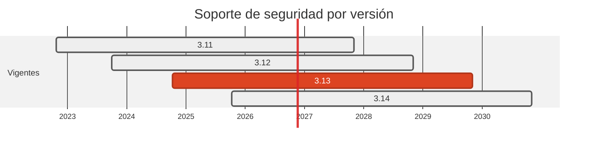

# 🐍 Python 3.11 → 3.13 (Debian 12 → 13)

> 3.11 sigue recibiendo parches, pero solo de seguridad. El cambio de verdad esta debajo: la imagen pasa de bookworm a trixie.

[← Volver al índice de actualizaciones](../VERSION_UPGRADES.md) · [README](../../README.md)

---

## Resumen

| | |
| :--- | :--- |
| **Casos afectados** | 7 (01, 02, 04, 08, 09, 12, 15) |
| **Cambios de versión registrados** | 7 |
| **Advisories cerrados en dependencias de este stack** | 15 |
| **Riesgo de ruptura** | Bajo, y verificado mas que el resto: el job `Build & Push to GHCR` **construye de verdad** la imagen del hub sobre 3 |

## Ventanas de soporte

| Versión | Publicada | Fin de soporte | Estado |
| :--- | :--- | :--- | :--- |
| `3.11` | 2022-10-24 | 2027-10-31 | solo-seguridad |
| `3.12` | 2023-10-02 | 2028-10-31 | solo-seguridad |
| `3.13` | 2024-10-07 | 2029-10-31 | **adoptada** |
| `3.14` | 2025-10-07 | 2030-10-31 | bleeding edge |

## Por qué se cambió

- Python 3.11 esta en modo **solo correcciones de seguridad** desde abril de 2024: no recibe correcciones de fallos normales. 3.13 da cuatro años mas de margen y sigue en soporte completo.

- El salto de base del sistema operativo pesa mas que el de Python: `python:3.11-slim-bookworm` es Debian 12, que ya es *oldstable*. `python:3.13-slim-trixie` es Debian 13, la estable actual, con ventanas de parches de OS mas largas para `openssl`, `zlib` y compania.

- No se va a 3.14 a propósito: los 8 locks del repositorio se compilan con `--generate-hashes`, y cuanto mas nueva es la versión menos ruedas precompiladas hay para `pydantic-core` o `grpcio`, lo que obligaria a compilar desde fuente dentro de la imagen.

## Una trampa que casi se cuela

El `Dockerfile` del hub borra `pip` de la imagen de runtime para dejar limpio el escaneo de Trivy, y lo hacia con **rutas hardcodeadas** `/usr/local/lib/python3.11/...`. Al cambiar la base, esos `rm -rf` habrían dejado de encontrar nada **sin fallar**, `pip` habría vuelto a la imagen y los hallazgos HIGH de Trivy habrían reaparecido en silencio. Las rutas se actualizaron a `python3.13`.

## Implementación — dónde quedó escrito cada cambio

Las rutas de esta tabla las verifica `scripts/validate_security_manifests.py` en CI: si alguna no existe, el pipeline falla.

| Caso | Componente | De | A | Motivo | Fichero y mecanismo |
| :--- | :--- | :--- | :--- | :--- | :--- |
| 01 | origin | `3.11` | `3.13` | `fin-de-soporte-activo` | `cases/01-python-to-php/origin/requirements.in` (pin de entrada (se recompila con hash)); `cases/01-python-to-php/origin/requirements.txt` (lock con hash SHA256); `Dockerfile` (FROM de la imagen) |
| 02 | origin | `3.11` | `3.13` | `fin-de-soporte-activo` | `cases/02-python-to-go/origin/requirements.in` (pin de entrada (se recompila con hash)); `cases/02-python-to-go/origin/requirements.txt` (lock con hash SHA256); `Dockerfile` (FROM de la imagen) |
| 04 | dest | `3.11-alpine` | `3.13-alpine` | `fin-de-soporte-activo` | `cases/04-node-to-fastapi/dest/Dockerfile` (FROM de la imagen) |
| 08 | dest | `3.11-slim (bookworm)` | `3.13-slim-trixie` | `fin-de-soporte-activo` | `cases/08-csharp-to-flask/dest/Dockerfile` (FROM de la imagen); `Dockerfile` (FROM de la imagen) |
| 09 | dest | `3.11-slim` | `3.13-slim-trixie` | `fin-de-soporte-activo` | `cases/09-python-to-gateway/dest/Dockerfile` (FROM de la imagen); `Dockerfile` (FROM de la imagen) |
| 12 | dest | `3.11-slim` | `3.13-slim-trixie` | `fin-de-soporte-activo` | `cases/12-python-to-rag/dest/Dockerfile` (FROM de la imagen); `Dockerfile` (FROM de la imagen) |
| 15 | dest | `3.11-slim` | `3.13-slim-trixie` | `fin-de-soporte-activo` | `cases/15-grpc-go-to-python/dest/Dockerfile` (FROM de la imagen); `Dockerfile` (FROM de la imagen) |

## Dependencias de este stack

| Caso | Paquete | De | A | Severidad | Advisories | Fichero y mecanismo |
| :--- | :--- | :--- | :--- | :--- | :--- | :--- |
| 01 | `certifi` | `2026.6.17` | `2026.10.23` | CRITICAL | GHSA-6q48-6c7w-9gw2, PYSEC-2026-4320 | `cases/01-python-to-php/origin/requirements.txt` (lock con hash SHA256) |
| 01 | `urllib3` | `2.7.0` | `2.8.0` | HIGH | GHSA-8988-9cw3-xx77, GHSA-vxq7-64xx-v4gw, GHSA-gh4c-6fx4-qh6g | `cases/01-python-to-php/origin/requirements.txt` (lock con hash SHA256) |
| 02 | `certifi` | `2026.6.17` | `2026.10.23` | CRITICAL | GHSA-6q48-6c7w-9gw2 | `cases/02-python-to-go/origin/requirements.txt` (lock con hash SHA256) |
| 02 | `urllib3` | `2.7.0` | `2.8.0` | HIGH | GHSA-8988-9cw3-xx77, GHSA-vxq7-64xx-v4gw | `cases/02-python-to-go/origin/requirements.txt` (lock con hash SHA256) |
| 04 | `fastapi` | `sin pin (pip install fastapi)` | `0.162.0 con hash SHA256` | - | — | `cases/04-node-to-fastapi/dest/requirements.in` (pin de entrada (se recompila con hash)); `cases/04-node-to-fastapi/dest/requirements.txt` (lock con hash SHA256) |
| 04 | `pydantic` | `sin pin` | `2.14.2 con hash SHA256` | - | — | `cases/04-node-to-fastapi/dest/requirements.in` (pin de entrada (se recompila con hash)); `cases/04-node-to-fastapi/dest/requirements.txt` (lock con hash SHA256) |
| 04 | `uvicorn` | `sin pin` | `0.54.0 con hash SHA256` | - | — | `cases/04-node-to-fastapi/dest/requirements.in` (pin de entrada (se recompila con hash)); `cases/04-node-to-fastapi/dest/requirements.txt` (lock con hash SHA256) |
| 08 | `werkzeug` | `3.1.8` | `3.1.9` | MODERATE | GHSA-g6x2-hccm-hh4m, PYSEC-2026-4312 | `cases/08-csharp-to-flask/dest/requirements.txt` (lock con hash SHA256) |
| 08 | `flask` | `3.1.x` | `3.1.3` | - | — | `cases/08-csharp-to-flask/dest/requirements.txt` (lock con hash SHA256) |
| 08 | `pyodbc` | `5.x` | `5.3.0` | - | — | `cases/08-csharp-to-flask/dest/requirements.txt` (lock con hash SHA256) |
| 09 | `anyio` | `4.14.1` | `4.16.0` | CRITICAL | GHSA-82r6-8w77-94w6, GHSA-3w57-8xmc-8v26, GHSA-5p39-cfhj-2xmp | `cases/09-python-to-gateway/dest/requirements.txt` (lock con hash SHA256) |
| 09 | `starlette` | `0.47.3` | `1.10.0 (resuelta por fastapi 0.162.0)` | HIGH | GHSA-wqp7-x3pw-xc5r, GHSA-7f5h-v6xp-fcq8, GHSA-x746-7m8f-x49c | `cases/09-python-to-gateway/dest/requirements.txt` (lock con hash; transitiva, no se declara en el .in) |
| 09 | `requests` | `2.32.4` | `2.34.2` | MODERATE | CVE-2026-25645, GHSA-gc5v-m9x4-r6x2 | `cases/09-python-to-gateway/dest/requirements.in` (pin de entrada (se recompila con hash)); `cases/09-python-to-gateway/dest/requirements.txt` (lock con hash SHA256) |
| 09 | `certifi` | `2026.6.17` | `2026.10.23` | CRITICAL | GHSA-6q48-6c7w-9gw2 | `cases/09-python-to-gateway/dest/requirements.txt` (lock con hash SHA256) |
| 09 | `urllib3` | `2.7.0` | `2.8.0` | HIGH | GHSA-8988-9cw3-xx77, GHSA-vxq7-64xx-v4gw | `cases/09-python-to-gateway/dest/requirements.txt` (lock con hash SHA256) |
| 09 | `fastapi` | `0.116.1` | `0.162.0` | - | — | `cases/09-python-to-gateway/dest/requirements.in` (pin de entrada (se recompila con hash)); `cases/09-python-to-gateway/dest/requirements.txt` (lock con hash SHA256) |
| 09 | `duckdb` | `1.3.2` | `2.0.0` | - | — | `cases/09-python-to-gateway/dest/requirements.in` (pin de entrada (se recompila con hash)); `cases/09-python-to-gateway/dest/requirements.txt` (lock con hash SHA256) |
| 09 | `pydantic` | `2.11.7` | `2.14.2` | - | — | `cases/09-python-to-gateway/dest/requirements.in` (pin de entrada (se recompila con hash)); `cases/09-python-to-gateway/dest/requirements.txt` (lock con hash SHA256) |
| 09 | `uvicorn` | `0.35.0` | `0.54.0` | - | — | `cases/09-python-to-gateway/dest/requirements.in` (pin de entrada (se recompila con hash)); `cases/09-python-to-gateway/dest/requirements.txt` (lock con hash SHA256) |
| 12 | `fastapi` | `0.115.6` | `0.162.0` | - | — | `cases/12-python-to-rag/dest/requirements.in` (pin de entrada (se recompila con hash)); `cases/12-python-to-rag/dest/requirements.txt` (lock con hash SHA256) |
| 12 | `uvicorn` | `0.34.0` | `0.54.0` | - | — | `cases/12-python-to-rag/dest/requirements.in` (pin de entrada (se recompila con hash)); `cases/12-python-to-rag/dest/requirements.txt` (lock con hash SHA256) |
| 12 | `psycopg2-binary` | `2.9.10` | `2.9.13` | - | — | `cases/12-python-to-rag/dest/requirements.in` (pin de entrada (se recompila con hash)); `cases/12-python-to-rag/dest/requirements.txt` (lock con hash SHA256) |
| 12 | `requirements.txt` | `3 pins sin hash` | `15 pins con hash SHA256` | - | — | `cases/12-python-to-rag/dest/requirements.in` (pins de entrada) + `requirements.txt` (lock con hash SHA256, 15 paquetes) |
| 15 | `grpcio` | `1.68.1` | `1.85.1` | - | — | `cases/15-grpc-go-to-python/dest/requirements.in` (pin de entrada (se recompila con hash)); `cases/15-grpc-go-to-python/dest/requirements.txt` (lock con hash SHA256) |
| 15 | `grpcio-tools` | `1.68.1` | `1.85.1` | - | — | `cases/15-grpc-go-to-python/dest/requirements.in` (pin de entrada (se recompila con hash)); `cases/15-grpc-go-to-python/dest/requirements.txt` (lock con hash SHA256) |
| 15 | `requirements.txt` | `4 pins sin hash` | `18 pins con hash SHA256` | - | — | `cases/15-grpc-go-to-python/dest/requirements.in` (pins de entrada) + `requirements.txt` (lock con hash SHA256, 18 paquetes) |

## Riesgo y verificación

Bajo, y verificado mas que el resto: el job `Build & Push to GHCR` **construye de verdad** la imagen del hub sobre 3.13-trixie y pasa. `mypy` con `python_version = 3.13` y los tests de los casos 01 y 02 también estan en verde.

## Fuentes

- <https://endoflife.date/python>
- <https://www.debian.org/releases/>
