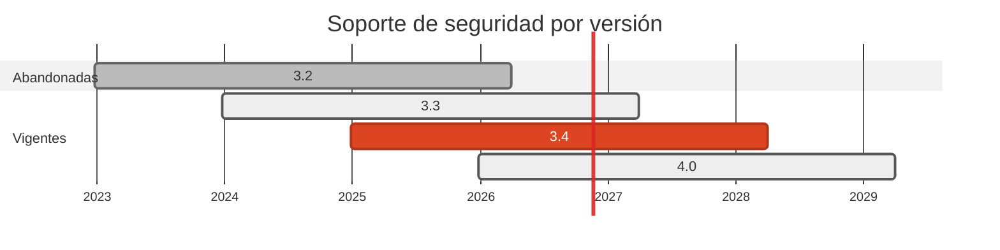

# 💎 Ruby 3.2 → 3.4

> 3.2 quedó EOL el 2026-03-31. Y el pipeline destapo algo peor en sus gemas que en el propio intérprete.

[← Volver al índice de actualizaciones](../VERSION_UPGRADES.md) · [README](../../README.md)

---

## Resumen

| | |
| :--- | :--- |
| **Casos afectados** | 1 (07) |
| **Cambios de versión registrados** | 1 |
| **Advisories cerrados en dependencias de este stack** | 4 |
| **Riesgo de ruptura** | Bajo para el intérprete |

## Ventanas de soporte

| Versión | Publicada | Fin de soporte | Estado |
| :--- | :--- | :--- | :--- |
| `3.2` | 2022-12-25 | 2026-03-31 | **EOL** |
| `3.3` | 2023-12-25 | 2027-03-31 | con soporte |
| `3.4` | 2024-12-25 | 2028-03-31 | **adoptada** |
| `4.0` | 2025-12-25 | 2029-03-31 | recien salida |

## Por qué se cambió

- La rama 3.2 dejó de recibir parches en marzo de 2026. 3.4 llega a 2028.

- Se queda en 3.4 en lugar de 4.0 porque el caso depende de `cassandra-driver`, una gema poco mantenida: cuanto mas nuevo el intérprete, mas probable es topar con una incompatibilidad que no tiene quien la arregle.

- `sorted_set` sigue siendo necesario: `SortedSet` salió de la biblioteca estándar en Ruby 3.2 y `cassandra-driver` lo usa.

## El hallazgo que no vio OSV

Con el intérprete ya actualizado, el job de Ruby se puso **rojo**: `bundler-audit` encontró **cuatro advisories de `rack` 3.2.6 publicados ese mismo día**, uno de ellos HIGH (`GHSA-5v64-555j-wjxm`, el parser multipart retiene lo ya parseado en su buffer de scan y permite agotar la memoria).

La consulta a OSV para esa misma versión devolvia **cero**: su `ruby-advisory-db` iba mas fresca que el índice de OSV. Se corrigió subiendo a 3.2.8 y, sobre todo, **fijando el piso en el `Gemfile`**: `sinatra` solo pide `>= 3.0.0, < 4`, así que sin piso explícito bundler puede volver a resolver una versión vulnerable manana.

Lección que queda en el repositorio: los auditores nativos de cada ecosistema no son redundantes con una consulta centralizada. Se quedan en CI y bloqueando.

## Implementación — dónde quedó escrito cada cambio

Las rutas de esta tabla las verifica `scripts/validate_security_manifests.py` en CI: si alguna no existe, el pipeline falla.

| Caso | Componente | De | A | Motivo | Fichero y mecanismo |
| :--- | :--- | :--- | :--- | :--- | :--- |
| 07 | dest | `3.2-alpine` | `3.4-alpine` | `eol` | `cases/07-rust-to-ruby/dest/Dockerfile` (FROM de la imagen) |

## Dependencias de este stack

| Caso | Paquete | De | A | Severidad | Advisories | Fichero y mecanismo |
| :--- | :--- | :--- | :--- | :--- | :--- | :--- |
| 07 | `sinatra` | `4.2.1 (Gemfile.lock)` | `4.2.1` | - | — | `cases/07-rust-to-ruby/dest/Gemfile.lock` (version resuelta por bundler) |
| 07 | `rack` | `3.2.6 (Gemfile.lock)` | `3.2.8` | HIGH | GHSA-5v64-555j-wjxm, GHSA-2j8w-xcrc-x985, GHSA-wvg4-6p58-3gh3, GHSA-p8x9-v4hv-2w4g | `cases/07-rust-to-ruby/dest/Gemfile` (piso de version de bundler); `cases/07-rust-to-ruby/dest/Gemfile.lock` (version resuelta por bundler) |

## Riesgo y verificación

Bajo para el intérprete. El riesgo real estaba en `rack` — ver el apartado siguiente.

## Fuentes

- <https://endoflife.date/ruby>
