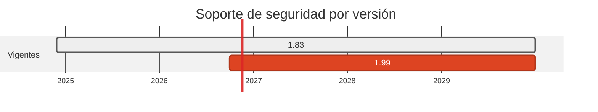

# 🦀 Rust 1.83 → 1.99

> Sin advisories en el toolchain, pero 16 releases de retraso. Y el `Cargo.lock` esconde cuatro hallazgos abiertos.

[← Volver al índice de actualizaciones](../VERSION_UPGRADES.md) · [README](../../README.md)

---

## Resumen

| | |
| :--- | :--- |
| **Casos afectados** | 2 (07, 17) |
| **Cambios de versión registrados** | 2 |
| **Advisories cerrados en dependencias de este stack** | 0 |
| **Riesgo de ruptura** | Bajo para el compilador; la edicion `2021` sigue soportada |

## Ventanas de soporte

| Versión | Publicada | Fin de soporte | Estado |
| :--- | :--- | :--- | :--- |
| `1.83` | 2024-11-28 | sin EOL formal | 16 releases atrás |
| `1.99` | 2026-10-01 | última estable | **adoptada** |

## Por qué se cambió

- Rust no tiene ramas de soporte: hay una estable cada seis semanas y la corrección llega en la siguiente. Quedarse en 1.83 (noviembre de 2024) no deja CVE abierto en el compilador, pero si deuda de dos años.

- El motivo real para moverlo es que el toolchain antiguo limita las versiones de crates que se pueden resolver, lo que a su vez bloquea las correcciones de seguridad de las dependencias.

## Hallazgos ABIERTOS en los Cargo.lock

`cargo audit` pasó en **verde** en CI. La consulta a OSV sobre las versiones exactas de los dos `Cargo.lock` encontró, en cambio, cinco crates vulnerables: `rustls` 0.23.41 (8 advisories, entre ellos secretos TLS expuestos por los `impl Debug` de sesion), `h2` 0.4.15, `rustls-webpki` 0.103.13 y `tokio` 1.52.3 en los dos casos.

**No estan corregidos.** El `Cargo.lock` lleva un checksum por crate y la lista de dependencias de cada versión: editarlo a mano no es verificable y romperia el build. La corrección correcta es `cargo update -p <crate>` en una máquina con toolchain Rust, que aquí no hay. Quedan declarados como `open_findings` en el `security.yml` de cada caso, y el guardrail obliga a que lleven severidad y versión de corrección. Dependabot (ecosistema `cargo`, que ahora **también** cubre el caso 17) regenera el lock correctamente.

Es el espejo del caso de `rack`: alli OSV se quedó corto y `bundler-audit` acertó; aquí `cargo audit` se quedó corto y acertó OSV.

## Implementación — dónde quedó escrito cada cambio

Las rutas de esta tabla las verifica `scripts/validate_security_manifests.py` en CI: si alguna no existe, el pipeline falla.

| Caso | Componente | De | A | Motivo | Fichero y mecanismo |
| :--- | :--- | :--- | :--- | :--- | :--- |
| 07 | origin | `toolchain stable en CI` | `toolchain stable en CI` | `sin-cambio` | (sin cambio: no se toco ningun fichero) |
| 17 | origin | `1.83-alpine` | `1.99-alpine` | `mantenimiento` | `cases/17-mqtt-rust-to-node/origin/Dockerfile` (FROM de la imagen) |

## Dependencias de este stack

| Caso | Paquete | De | A | Severidad | Advisories | Fichero y mecanismo |
| :--- | :--- | :--- | :--- | :--- | :--- | :--- |
| 07 | `reqwest` | `0.12` | `0.12` | - | — | `cases/07-rust-to-ruby/origin/Cargo.toml` (dependencia de cargo) |
| 07 | `dotenvy` | `0.15` | `0.15` | - | — | `cases/07-rust-to-ruby/origin/Cargo.toml` (dependencia de cargo) |
| 17 | `rumqttc` | `0.24` | `0.24` | - | — | `cases/17-mqtt-rust-to-node/origin/Cargo.toml` (dependencia de cargo) |

## Riesgo y verificación

Bajo para el compilador; la edicion `2021` sigue soportada. Pero ver el apartado de hallazgos abiertos: lo que si esta vulnerable son crates transitivas del lock.

## Fuentes

- <https://endoflife.date/rust>
- <https://releases.rs/>
