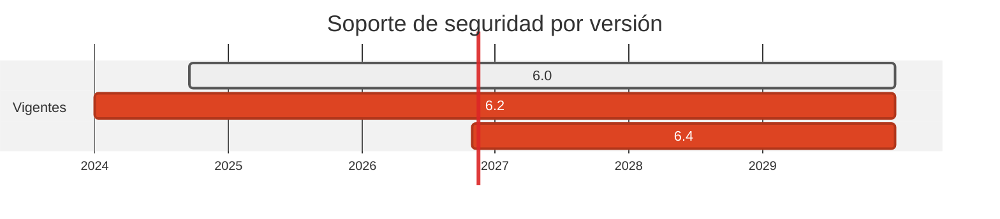

# 🧡 Swift 6.0 → 6.2

> Mantenimiento: dos años de retraso en el emisor del caso 20.

[← Volver al índice de actualizaciones](../VERSION_UPGRADES.md) · [README](../../README.md)

---

## Resumen

| | |
| :--- | :--- |
| **Casos afectados** | 1 (20) |
| **Cambios de versión registrados** | 1 |
| **Advisories cerrados en dependencias de este stack** | 0 |
| **Riesgo de ruptura** | Bajo |

## Ventanas de soporte

| Versión | Publicada | Fin de soporte | Estado |
| :--- | :--- | :--- | :--- |
| `6.0` | 2024-09-17 | sin EOL formal | 2 años atrás |
| `6.2` | 2025-09-? | rama soportada | **adoptada** |
| `6.4` | 2026-10-30 | última | no adoptada |

## Por qué se cambió

- Swift no publica ventanas de soporte por rama; la corrección llega en la siguiente versión.

- Se va a 6.2 y no a 6.4 porque el `Package.swift` declara `swift-tools-versión:5.9` y 6.2 es la rama mas rodada que lo sigue aceptando sin cambios.

## Implementación — dónde quedó escrito cada cambio

Las rutas de esta tabla las verifica `scripts/validate_security_manifests.py` en CI: si alguna no existe, el pipeline falla.

| Caso | Componente | De | A | Motivo | Fichero y mecanismo |
| :--- | :--- | :--- | :--- | :--- | :--- |
| 20 | origin | `6.0 / 6.0-slim` | `6.2 / 6.2-slim` | `mantenimiento` | `cases/20-swift-to-dart/origin/Dockerfile` (FROM de la imagen) |

## Riesgo y verificación

Bajo. El emisor es un ejecutable con `URLSession` y `Codable`. No se compila en el pipeline.

## Fuentes

- <https://www.swift.org/download/>
