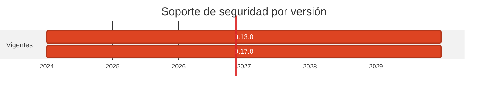

# ⚡ Zig 0.13: por qué NO se subió

> La decision de no tocar algo también es una decision, y merece quedar escrita.

[← Volver al índice de actualizaciones](../VERSION_UPGRADES.md) · [README](../../README.md)

---

## Resumen

| | |
| :--- | :--- |
| **Casos afectados** | 1 (18) |
| **Cambios de versión registrados** | 1 |
| **Advisories cerrados en dependencias de este stack** | 0 |
| **Riesgo de ruptura** | Ninguno anadido |

## Ventanas de soporte

| Versión | Publicada | Fin de soporte | Estado |
| :--- | :--- | :--- | :--- |
| `0.13.0` | 2024-06-? | sin EOL formal | **se mantiene** |
| `0.17.0` | 2026-? | última | no adoptada |

## Por qué se cambió

- Zig **no tiene ningun advisory** en OSV: no hay un fallo de seguridad que subir de versión cierre.

- La ruta 0.13 → 0.17 rompe el sistema de build. La 0.15 reescribió la API de `std.Io` (lo que la comunidad llamo *Writergate*), de modo que el `build.zig` y el código del emisor necesitarian reescritura.

- No hay toolchain Zig en esta máquina ni en el pipeline: el caso solo se compila dentro de su imagen Docker. Subir a ciegas una versión que rompe la API, sin poder compilar y sin un CVE que lo justifique, es cambiar por cambiar.

- Lo que **si** se parcheo es la capa que de verdad tenia riesgo: la Alpine sobre la que compila, de 3.20 (sin parches desde el 2026-04-01) a 3.23.7.

## Implementación — dónde quedó escrito cada cambio

Las rutas de esta tabla las verifica `scripts/validate_security_manifests.py` en CI: si alguna no existe, el pipeline falla.

| Caso | Componente | De | A | Motivo | Fichero y mecanismo |
| :--- | :--- | :--- | :--- | :--- | :--- |
| 18 | origin | `0.13.0` | `0.13.0` | `sin-cambio` | (sin cambio: no se toco ningun fichero) |

## Riesgo y verificación

Ninguno anadido. El riesgo que queda es la deuda tecnica de un toolchain de 2024, no una vulnerabilidad.

## Fuentes

- <https://ziglang.org/download/>
- <https://osv.dev/>
